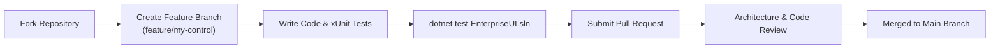

# Contributing to EnterpriseUI

Thank you for your interest in contributing to **EnterpriseUI**, the world's most complete open-source enterprise UI framework for .NET 8+!

EnterpriseUI is governed as an open, community-driven project under the **Apache License, Version 2.0**. We welcome contributions from developers, architects, accessibility specialists, designers, and technical writers worldwide.

---

## 1. Code of Conduct

This project adheres to the Contributor Covenant Code of Conduct. By participating, you are expected to uphold this code. Please report unacceptable behavior to `conduct@enterpriseui.org`.

---

## 2. Open Source Principles

To maintain absolute independence and compliance:

- **100% Original Code**: Never submit decompiled code, proprietary vendor snippets, or reverse-engineered implementations from closed-source commercial libraries (such as DevExpress, Telerik, or Syncfusion).
- **Zero Commercial Dependencies**: Pull requests introducing commercial SDK dependencies, proprietary licensing logic, activation requirements, or phone-home telemetry will be rejected immediately.
- **Clean-Room Implementation**: All controls, algorithms, and features must be authored independently based on open specifications, web standards, and public documentation.

---

## 3. Contribution Workflow



### Steps to Contribute:

1. **Find or Open an Issue**: Before undertaking significant work, open an RFC (Request for Comments) issue to discuss architecture, API design, and scope.
2. **Fork and Clone**:
   ```bash
   git clone https://github.com/enterpriseui/enterpriseui.git
   cd enterpriseui
   dotnet build EnterpriseUI.sln
   ```
3. **Branching Convention**:
   - `feature/feature-name`
   - `fix/bug-description`
   - `docs/topic-name`
   - `perf/optimization-target`
4. **Code Quality Standards**:
   - Nullable reference types enabled (`#nullable enable`).
   - Warning level must be 0 warnings (treat warnings as errors in CI).
   - Public APIs must include XML doc comments (`/// <summary>...`).
   - Unit tests required for all business logic, query expressions, and algorithms in `tests/UnitTests`.
5. **Run Tests Locally**:
   ```bash
   dotnet test tests/UnitTests/UnitTests.csproj
   ```

---

## 4. Architectural Review Process (RFC)

Any breaking change, new control category, or core platform shift requires an RFC:

1. Create a markdown proposal in `docs/Architecture/RFC/`.
2. Follow the RFC template:
   - **Summary & Motivation**
   - **Detailed Design & Class Hierarchy**
   - **Breaking Changes & Migration**
   - **Drawbacks & Alternatives Considered**
3. Open a Pull Request tagged with `rfc` and allow 14 calendar days for community and maintainer review.

---

## 5. Developer Certificate of Origin (DCO)

By submitting a pull request, you certify that you have the right to submit the work under the Apache 2.0 license:

```
Signed-off-by: Jane Developer <jane.dev@example.com>
```
Use `git commit -s` to automatically add this line to your commits.

