# EnterpriseUI: The Open Source Enterprise UI Platform for .NET

[](LICENSE)
[](https://dotnet.microsoft.com/)
[](LICENSE)

**EnterpriseUI** is an open-source component platform for **.NET 8+**, with shared framework libraries, platform adapters, a theme engine, and a Windows Forms Demo Center.

Controls, models, and services have different platform coverage. Consult the component guides and runnable demos for supported APIs and workflows.

---

## 📸 Visual Showcase Gallery (`EnterpriseUI.WinFormsDemo`)

### 1. Million-Row Virtualized DataGrid (Light & Dark Themes)
Constant-memory `O(1)` viewport virtualization over 1,000,000 records with multi-column sorting, hierarchical grouping, stacked header bands, inline conditional data bars, master-detail expansion, and live 8-format code generation.

#### Light Theme (`Windows-Light` / `Fluent-Light`)


#### Dark Theme (`Fluent-Dark` / `Obsidian-Dark`)


---

### 2. Executive BI Dashboard & Real-Time KPI Cards
Responsive executive business intelligence workspace combining KPI metric cards, multi-series revenue trend charts, and live operational data grids.

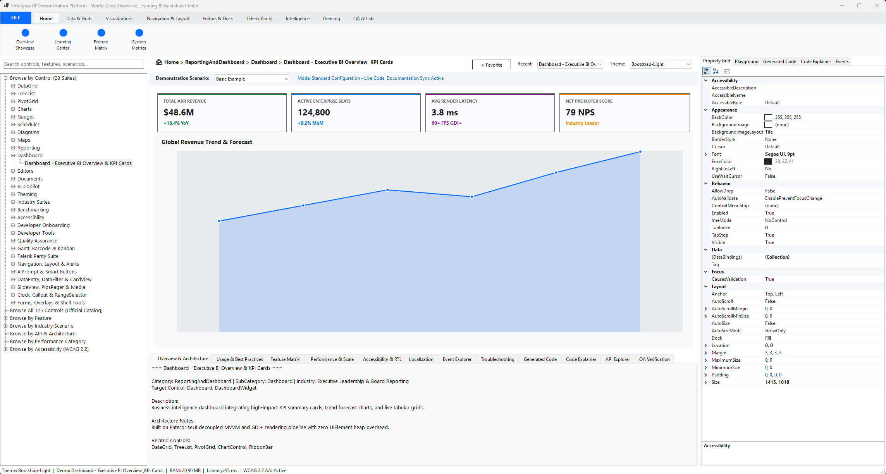

---

### 3. Financial Candlesticks & Real-Time Multi-Series Charts
Hardware-accelerated GDI+ vector charting supporting Candlestick (OHLC), Bar, Column, Line, Spline, Area, Pie, Donut, EnterpriseSparkline, and EnterpriseHeatMap series with live streaming telemetry.

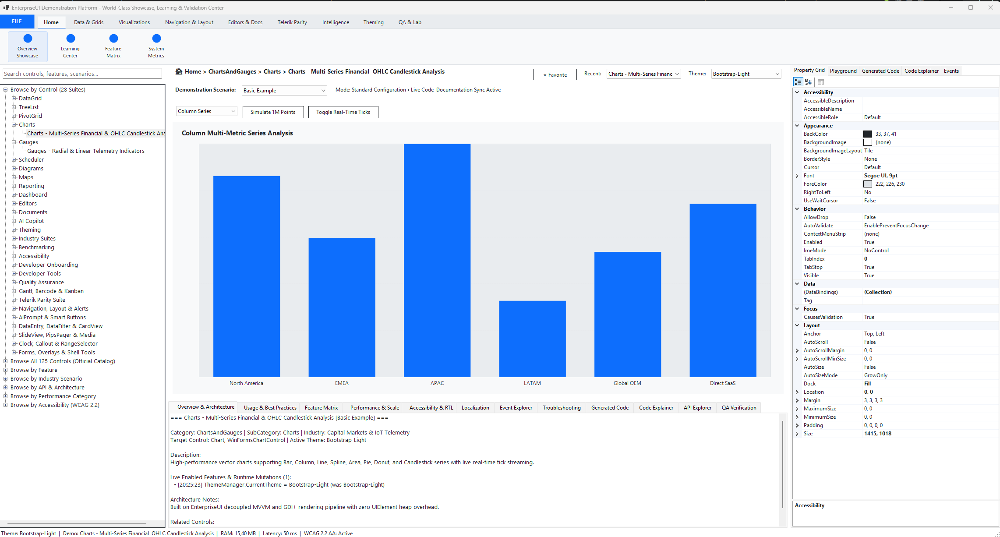

---

### 4. Radial, Linear, Digital & Stephen Few EnterpriseBulletGraph Gauges
Precision circular, linear, 7-segment digital, and Stephen Few KPI EnterpriseBulletGraph telemetry indicators with threshold color ranges and smooth needle transitions.

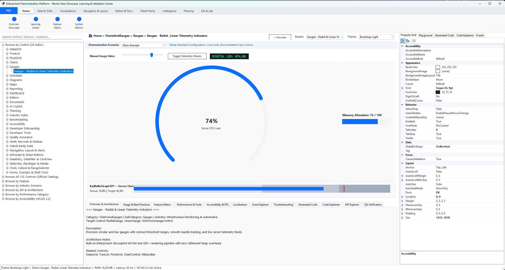

---

### 5. Project Gantt EnterpriseChart, Barcode/QR Generator & Agile Kanban Board
Interactive EnterpriseGanttView with critical-path dependency arrows and progress bars, vector QR/Code128/DataMatrix barcode rendering, EnterpriseTreeMap, SignaturePad, and VirtualKeyboard.

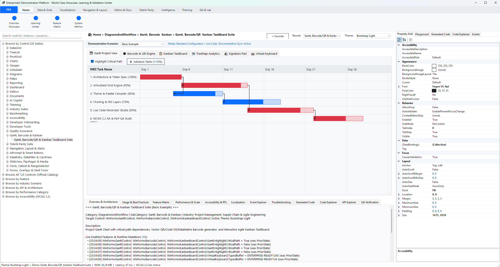

---

### 6. Enterprise Resource EnterpriseScheduler & Multi-View Calendar
Full-featured scheduling canvas supporting Day, Work Week, Week, Month, and Timeline views with RFC 5545 recurrence rules and resource lanes.

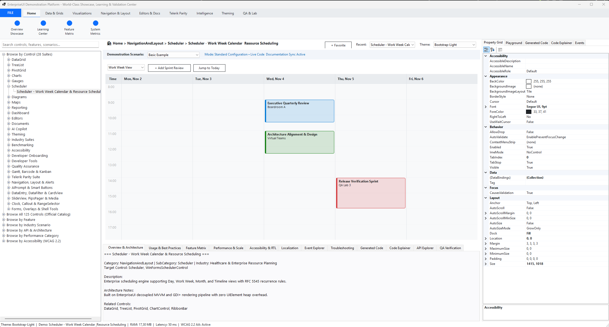

---

### 7. Interactive Architecture & Workflow Diagrams
Node-link diagramming canvas with orthogonal and Bezier connector routing, grid snapping, zoom/pan, and automated graph layout.

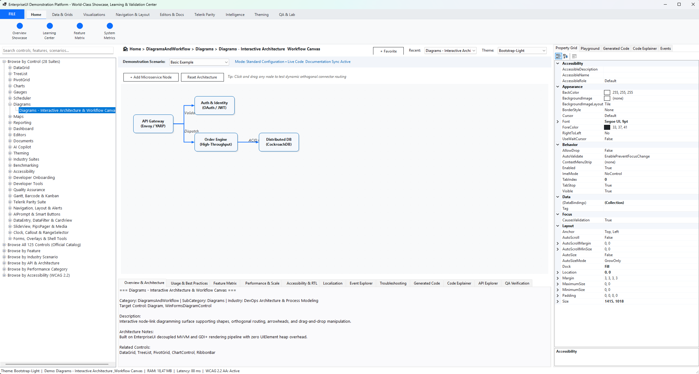

---

### 8. Themed Form Controls, Editors, Buttons & Fluent Validation
Custom GDI+ themed `TextBox` (prefix icons, clear `✕` button, focus ring, validation border), `ButtonTextBox` / `BrowseEditor`, `ToggleSwitch`, `SplitButton`, `RepeatButton`, `FontDropDownList`, `EnterpriseMaskedTextBox`, `EnterpriseAutoCompleteBox`, `EnterpriseCalculatorDropDown`, `EnterpriseSyntaxEditor`, and `SpellChecker`.

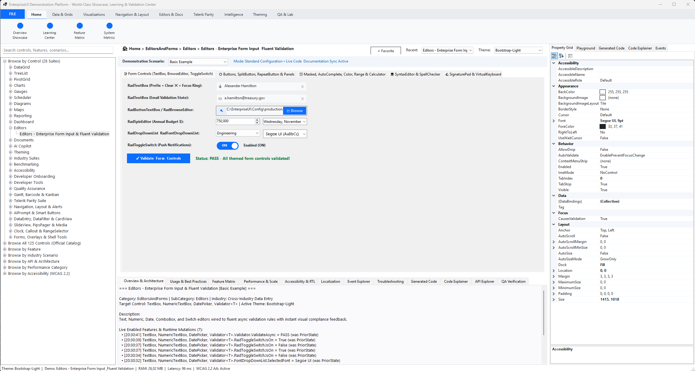

---

### 9. Navigation, EnterpriseBreadcrumb, EnterpriseStepProgressBar, EnterpriseCarousel, EnterprisePanorama & Wizard
Complete enterprise shell navigation including `EnterpriseRibbonBar`, `EnterpriseDockManager`, `EnterpriseBreadcrumb`, `EnterpriseStepProgressBar`, `EnterpriseBindingNavigator`, 3D Elliptical `EnterpriseCarousel`, Windows Live Tile `EnterprisePanorama`, `EnterpriseWizardControl`, `EnterpriseDesktopAlert`, and `EnterpriseTaskDialog`.

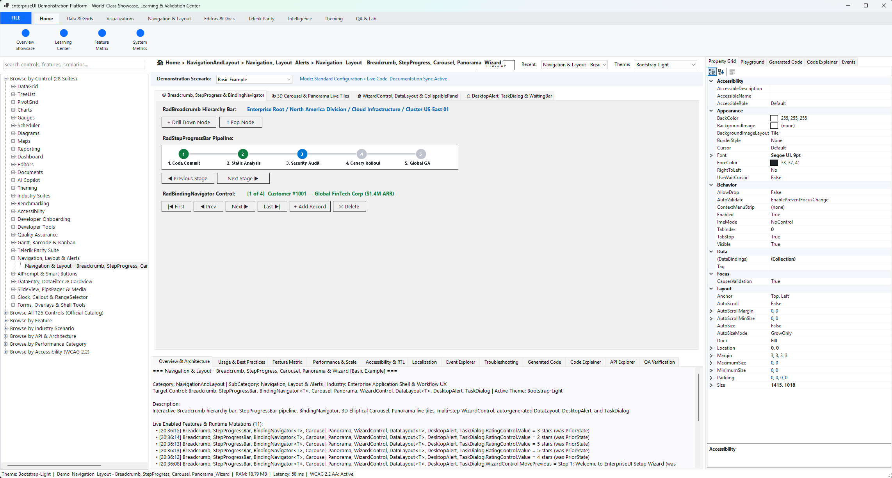

---

### 10. Multi-Format Document Workstation (PDF, RichText, Spreadsheet & Zip)
Integrated office document suite with vector `EnterprisePdfViewer`, WYSIWYG `EnterpriseRichTextEditor`, formula-driven `Spreadsheet` (`=SUM`, `=AVERAGE`, `=IF`), and in-memory `ZipArchive` compression.

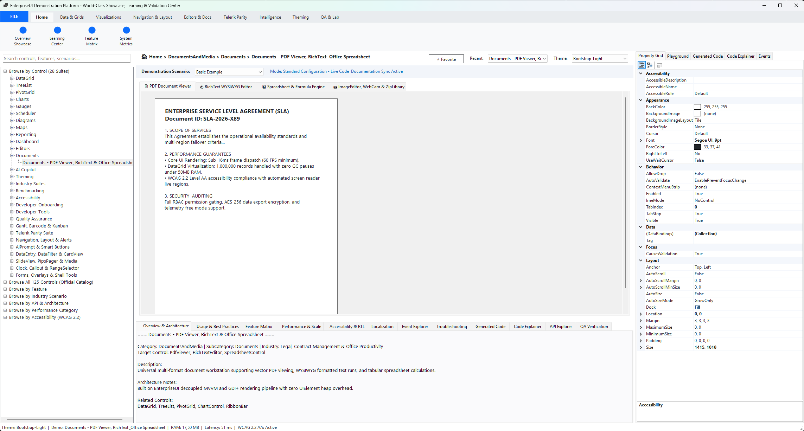

---

### 11. Banded Enterprise Reporting & Print Preview
Banded report designer and viewer supporting Report Header, Page Header, Group Header/Footer, Detail, and Page Footer bands with vector print and PDF export.

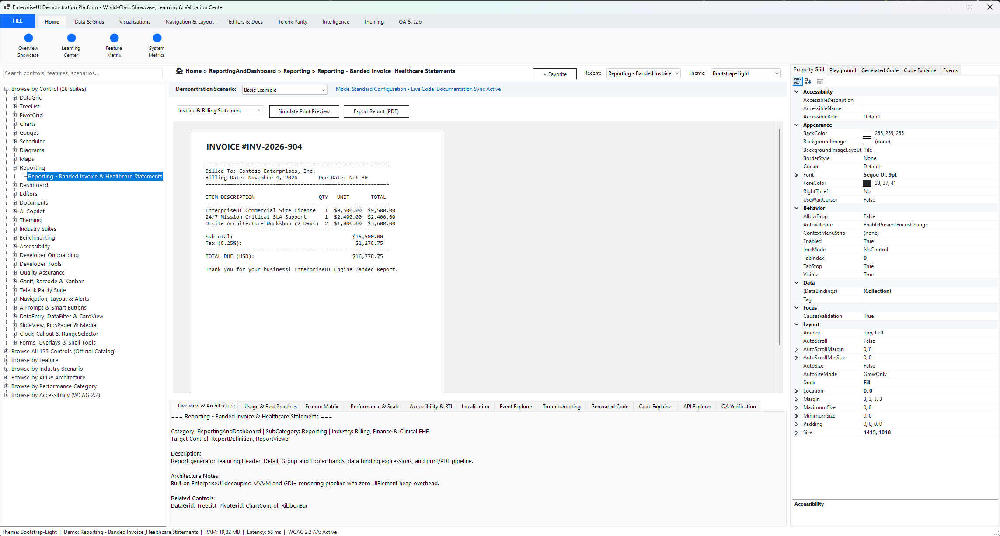

---

### 12. Vector Analog/Digital Clock, Callout Annotations & RangeSelector
Complete 118-control catalog explorer featuring multi-timezone vector `Clock`, directional `Callout` annotation balloons, dual-thumb `RangeSelector` chart zoom, `AIPrompt`, `SmartPasteButton`, `SlideView`, `Rotator`, and `PipsPager`.

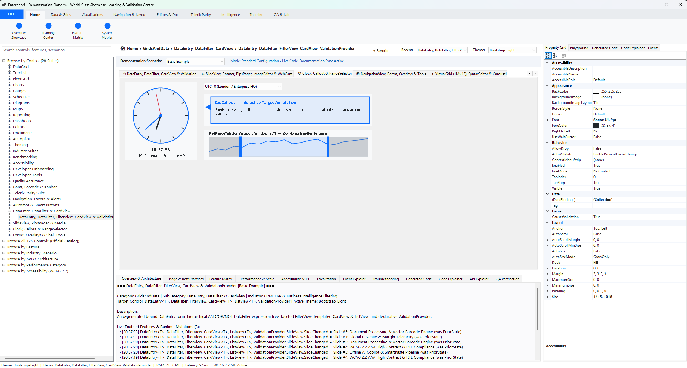

---

## ⚡ The Open Source Guarantee

- **Zero License Keys & Activation**: No trials, no hardware locks, no activation prompts, no expiration timers.
- **Zero Telemetry**: No phone-home tracking, data collection, or network pings.
- **Zero Commercial Dependencies**: Fully self-contained on the standard .NET 8 BCL. Compiles directly from `git clone` and `dotnet build`.
- **Apache-2.0 License**: Permissive, commercially viable, with explicit patent grants and trademark protections. Free for commercial, SaaS, internal enterprise, and educational deployment.

---

## Component Catalog


| Category | Included Controls |
| :--- | :--- |
| **1. AI & Smart Controls** | `AIPrompt`, `AIPromptButton`, `SmartPasteButton`, `SpeechToTextButton`, `ConversationalChat` (`AIChatView`) |
| **2. Grids, Data & Filtering** | `DataGrid<T>` (1M-row virtualized), `EnterpriseVirtualGrid` (`1M×12` `CellValueNeeded`), `EnterpriseTreeList<T>`, `EnterprisePivotGrid<T>`, `EnterpriseCardView<T>`, `ListView<T>`, `DataFilter`, `EnterpriseFilterView`, `DataEntry<T>` |
| **3. Buttons & Switches** | `Button` (`Primary`/`Success`/`Danger`/`Outline`/`Badge`), `CheckBox` (Tri-state), `RadioButton`, `ToggleButton`, `ToggleSwitch`, `DropDownButton`, `SplitButton`, `RepeatButton` |
| **4. Editors, Pickers & Lists** | `TextBox`, `TextBoxControl`, `ButtonTextBox`, `BrowseEditor`, `MaskedEditBox`, `SpinEditor`, `DomainUpDown`, `EnterpriseAutoCompleteBox`, `PopupEditor`, `EnterpriseCalculatorDropDown`, `Calculator`, `ColorBox`, `DateTimePicker`, `DateOnlyPicker`, `TimePicker`, `TimeOnlyPicker`, `EnterpriseTimeSpanPicker`, `DropDownList`, `ListControl`, `EnterpriseCheckedDropDownList`, `CheckedListBox`, `FontDropDownList`, `EnterpriseMultiColumnComboBox`, `PropertyGrid` |
| **5. Charts, Gauges, Maps & Diagrams** | `ChartView` (17 series types), `EnterpriseSparkline`, `RangeSelector`, `EnterpriseHeatMap`, `EnterpriseTreeMap`, `EnterpriseRadialGauge`, `EnterpriseLinearGauge`, `EnterpriseBulletGraph`, `EnterpriseDigitalGauge`, `EnterpriseGeoMap`, `EnterpriseDiagram`, `BarcodeView` (QR, Code128, DataMatrix) |
| **6. Scheduling & Project Management** | `EnterpriseScheduler`, `Calendar`, `EnterpriseGanttView` (with Critical Path), `TaskBoard` (Kanban) |
| **7. Navigation, Layout & Docking** | `EnterpriseRibbonBar`, `EnterpriseDockManager`, `EnterprisePageView`, `NavigationView` (Hamburger rail), `OfficeNavigationBar` (with Peek Popup), `BreadCrumb`, `EnterpriseBindingNavigator`, `EnterpriseCommandBar`, `EnterprisePanorama` (Live Tiles), `EnterpriseCarousel` (3D Elliptical), `Rotator`, `SlideView`, `PipsPager`, `Wizard`, `LayoutControl`, `EnterpriseDataLayout`, `SplitContainer`, `EnterpriseCollapsiblePanel`, `GroupBox`, `Panel`, `ScrollablePanel`, `Label`, `Separator`, `Menu` / `ContextMenu` / `ApplicationMenu` |
| **8. Documents & Code Editors** | `EnterpriseRichTextEditor`, `Spreadsheet`, `EnterprisePdfViewer`, `EnterpriseSyntaxEditor` (AST Tokenizer), `SpellChecker` (Levenshtein), `DocumentProcessingSuite` (`Words`, `Spread`, `Pdf`, `Zip`) |
| **9. Track, Status, Alerts & Overlays** | `ProgressBar`, `EnterpriseStepProgressBar`, `EnterpriseWaitingBar`, `Rating`, `TrackBar` (`RangeSlider`), `ScrollBar`, `EnterpriseDesktopAlert`, `ToastNotificationManager`, `NotifyIcon`, `Callout`, `SplashScreen`, `Overlay`, `Flyout`, `TaskbarButton` |
| **10. Forms, Dialogs, Media & Tools** | `ThemedForm`, `RibbonForm`, `TabbedForm`, `ToolbarForm`, `ShapedForm`, `TitleBar`, `StatusStrip`, `ThemedMessageBox`, `EnterpriseTaskDialog`, `ColorDialog`, `OpenFileDialog` / `SaveFileDialog` / `OpenFolderDialog`, `Clock`, `EnterpriseImageEditor`, `PictureBox`, `EnterpriseWebCam`, `VirtualKeyboard`, `SignaturePad`, `ValidationProvider`, `ShortcutsManager`, `ControlSpy` / `ShapeEditor` / `VisualStyleBuilder` / `MarkupDialog` |

---

## 📦 Quick Start

### 1. Build from Source
```bash
git clone https://github.com/enterpriseui/enterpriseui.git
cd enterpriseui
dotnet build EnterpriseUI.slnx -c Release
```

### 2. Launch the Interactive WinForms Demonstration Platform
```bash
dotnet run --project samples/EnterpriseUI.WinFormsDemo/EnterpriseUI.WinFormsDemo.csproj
```

### 3. Run the Unit Test Suite
```bash
dotnet test tests/EnterpriseUI.UnitTests/EnterpriseUI.UnitTests.csproj -c Release
```

### 4. Run High-Performance Benchmarks
```bash
dotnet run --project benchmarks/EnterpriseUI.Benchmarks/EnterpriseUI.Benchmarks.csproj -c Release
```

---

## 🏛️ Ecosystem Architecture

```
EnterpriseUI.sln / EnterpriseUI.slnx
├── src/            # 31 headless domain core and component libraries
├── platforms/      # WinForms, WPF, Blazor, ASP.NET Core, .NET MAUI
├── tooling/        # ThemeDesigner, VisualDesigner, TemplateStudio, CodeGenerators
├── tests/          # Unit, integration, performance, accessibility and UI automation tests
├── benchmarks/     # High-throughput benchmarks with BenchmarkDotNet / Stopwatch
├── samples/        # EnterpriseUI.WinFormsDemo (28 interactive suites + Live Playground & 8-Format CodeGen)
└── docs/           # Architecture, setup, component, theme and testing guides
```

---

## 📜 Documentation

- [Master Documentation Portal](docs/README.md)
- [System Architecture & C4 Models](docs/Architecture/SystemArchitecture.md)
- [DataGrid Architecture & Performance Guide](docs/Grid/ArchitectureGuide.md)
- [Theming System & Design Tokens](docs/Themes/ThemingEngineAndTokens.md)
- [Controls Catalog & API Reference](docs/Controls/UnifiedControlsCatalog.md)
- [Contribution Guidelines](CONTRIBUTING.md)

---

## ⚖️ License

EnterpriseUI is open-source software licensed under the [Apache License, Version 2.0](LICENSE).
Free for commercial, enterprise, SaaS, and private use without fees or activation keys.
