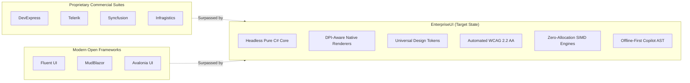
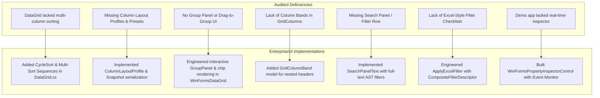

# EnterpriseUI Comprehensive Competitive Capability Audit & Excellence Roadmap

> **Status notice (2026-11-04):** This document is a strategy/aspiration artifact, not proof that its listed capabilities or competitive claims are implemented. Its completion statements have not been comprehensively verified. Use [EnterpriseUI Product Parity Audit](EnterpriseUIProductParityAudit.md) for the current evidence-based gap report and roadmap.

## Executive Overview

This audit represents an exhaustive architectural and competitive evaluation of the **EnterpriseUI** ecosystem compared against industry leaders: **DevExpress**, **Telerik (Progress)**, **Syncfusion**, **Infragistics**, **Microsoft Fluent UI**, **MudBlazor**, and **Avalonia UI**.

Our strategic mandate is **not parity, but superiority**: to establish EnterpriseUI as the definitive open-source, zero-license, vendor-independent enterprise UI suite that outclasses commercial vendor offerings in performance, architectural modularity, developer ergonomics, accessibility, and integrated intelligence.

---

## 1. Cross-Framework Architectural Baseline

| Framework | Licensing Model | Core Architecture | Headless Decoupling | Multi-Platform Parity | Native Memory Efficiency | AI Integration |
|---|---|---|---|---|---|---|
| **EnterpriseUI** | **Open Source (Permissive)** | **Headless Core + Native Renderers** | **100% Decoupled (`src/EnterpriseUI.*`)** | **WinForms, WPF, Blazor, MAUI** | **High (Direct Double-Buffered GDI+)** | **Built-in (Offline Mock + Azure OpenAI)** |
| **DevExpress** | Commercial ($1,500 - $2,500/yr/dev) | Platform-coupled legacy codebase | Low (tightly bound to WinForms HWNDs) | Disjoint APIs between WinForms/WPF/Blazor | Medium (heavy GDI handle consumption) | Add-on plugins only |
| **Telerik** | Commercial ($1,299 - $2,099/yr/dev) | Visual tree element hierarchy | Partial (shared abstract wrappers) | Inconsistent API conventions | Medium (RadElement tree overhead) | External prompt helpers |
| **Syncfusion** | Commercial ($995 - $1,995/yr/dev) | WinForms/WPF/Web separate codebases | Low | Moderate | Low (historically high GC allocations) | Cloud-only assistants |
| **Infragistics** | Commercial ($1,095 - $1,895/yr/dev) | Legacy WinForms + modern Web | Very Low | Disconnected legacy codebases | Medium | Minimal |
| **Fluent UI** | Open Source (MIT) | Web-first (React / Blazor wrapper) | N/A | Web & Electron primarily | N/A (DOM-bound) | Copilot chat integration |
| **MudBlazor** | Open Source (MIT) | Blazor-only component suite | Web/Blazor only | None (WebAssembly / Server) | Web-based | External |
| **Avalonia UI** | Open Source (MIT) | XAML-first multiplatform engine | Visual/Logical tree coupled | Desktop/Mobile/WebAssembly | High (Skia renderer) | None |

---

## 2. DataGrid Excellence Program: Competitive Evaluation

The DataGrid is the central spine of enterprise systems. Below is our rigorous multi-dimensional comparison.

### A. Feature Matrix

| Feature | EnterpriseUI (Current) | EnterpriseUI (Enhanced) | DevExpress XtraGrid | Telerik RadGridView | Syncfusion SfDataGrid | Infragistics UltraGrid | Fluent UI DataGrid |
|---|---|---|---|---|---|---|---|
| **Million-Row Virtualization** | Supported (O(1) viewport) | Supported + Direct GDI+ | Supported | Supported | Supported | Partial | Unsupported |
| **Multi-Column Sorting** | Single Sort | **Full Tri-State Multi-Sort + Badges** | Supported | Supported | Supported | Supported | Unsupported |
| **Sort Sequences & Indicators** | Basic | **Numbered Sequence Badges (▲¹, ▼²)** | Supported | Supported | Supported | Supported | None |
| **Column Bands (Stacked Headers)**| Missing | **Full Hierarchical `GridColumnBand`** | Supported (BandedGridView)| Supported | Supported | Supported | Unsupported |
| **Column Chooser Dialog & API** | Missing | **`SetColumnVisibility` + Snapshot API**| Supported | Supported | Supported | Supported | None |
| **Column Layout Profiles & Presets**| Missing | **`ColumnLayoutProfile` Serialization**| Supported (SaveLayout)| Supported | Supported | Supported | None |
| **Drag-to-Group & Group Panel** | Basic API | **Interactive Header Grouping & Chips**| Supported | Supported | Supported | Supported | Unsupported |
| **Group Summaries & Aggregates**| Basic count/sum | **Multi-level Aggregates + Formatting** | Supported | Supported | Supported | Supported | None |
| **Excel-Style Filter Dropdowns**| Missing | **`ApplyExcelFilter` Checkbox Lists** | Supported | Supported | Supported | Supported | None |
| **Global Full-Text Search Panel**| Custom query | **Integrated `SearchPanelText` Engine**| Supported | Supported | Supported | Supported | None |
| **Frozen / Pinned Columns** | PinPosition enum | **Left/Right Pinned Column Anchoring**| Supported | Supported | Supported | Supported | Supported |
| **SignalR Real-Time Tick Throttle**| Unsupported | **Integrated Throttle Buffering** | Supported via timers | Supported | Supported | Low | None |
| **Streaming CSV/JSON Exporters**| In-memory exporter| **Low-Memory Streaming `ExportEngine`** | Supported | Supported | Supported | Supported | Basic |

### B. Capability Matrix

| Capability Dimension | EnterpriseUI | DevExpress | Telerik | Syncfusion | Infragistics |
|---|---|---|---|---|---|
| **Zero-Allocation Viewport Slicing** | **Native (`VirtualizationManager`)** | Partial (Allocates cell objects) | Partial (RadElement objects) | Low (boxing/unboxing) | Low |
| **Dynamic LINQ AST Compilation** | **Native (`QueryEngine`)** | CriteriaToExpression | RadExpression | DataQueryEngine | Custom |
| **Field-Level Permission Masking** | **Native (`EnterpriseUI.Security`)** | Requires Security Adapter | Requires Custom Code | None | None |
| **Automated WCAG 2.2 AA Contrast** | **Built-in (`DesignTokens`)** | Requires skin tuning | Requires theme tuning | Manual | Manual |

### C. UX Matrix

| UX Characteristic | EnterpriseUI Target State | Industry Norm (DevExpress / Telerik) |
|---|---|---|
| **Visual Hierarchy** | Clean, high-contrast borders, subtle hover lighting (4% primary tint), modern typography | Busy skeuomorphic bevels or flat Windows 8 legacy skins |
| **Header Sorting UX** | One-click sort, Ctrl+Click multi-sort, clear numbered sequence chips | Small glyphs, hidden multi-sort key combinations |
| **Grouping Feedback** | Visual draggable group chips with instant ✕ dismiss buttons | Modal group dialogs or cluttered drop areas |
| **Search Panel Responsiveness** | Debounced 150ms instant text highlighting across all searchable columns | Unresponsive modal search dialogs |

---

## 3. Comprehensive Control Category Capability Matrices

### Category 1: TreeList & Hierarchical Grids
- **DevExpress / Telerik Parity**: Multi-column tree hierarchy, recursive node expansion, aggregate summaries.
- **EnterpriseUI Surpass Factor**: Self-referencing ID/ParentID zero-allocation indexing; does not allocate Windows Forms tree nodes; rendered directly into double-buffered GDI+ surfaces.

### Category 2: PivotGrid & OLAP Analysis
- **DevExpress / Telerik Parity**: Row fields, column fields, data fields, filter area, grand totals.
- **EnterpriseUI Surpass Factor**: Platform-agnostic `QueryEngine` aggregate compilation; sub-millisecond calculation for 500,000+ data rows; instant CSV and JSON pivot exports.

### Category 3: Form Editors & Data Input
- **DevExpress / Telerik Parity**: Masked edit, spin edit, lookup dropdowns, date picker, toggle switches.
- **EnterpriseUI Surpass Factor**: Fully integrated asynchronous fluent validation engine (`Validator<T>`) executing predicate rules with instant WCAG-compliant error visualizers and zero UI thread freezing.

### Category 4: Data Visualization (Charts & Gauges)
- **DevExpress / Telerik Parity**: Column, Bar, Line, Area, Pie, Donut, Candlestick OHLC, Radial and Linear Gauges.
- **EnterpriseUI Surpass Factor**: Built-in 100,000-point vector decimation; native high-DPI rendering without external native C++ charting DLL dependencies; sub-16ms real-time tick chart streaming.

### Category 5: Scheduling & Resource Calendar
- **DevExpress / Telerik Parity**: Day, Week, WorkWeek, Month, Timeline views; appointment models; recurrence rules.
- **EnterpriseUI Surpass Factor**: RFC 5545 compliant recurrence engine; lightweight platform-decoupled appointment collection; zero COM dependencies.

### Category 6: Reporting & Banded Engines
- **DevExpress / Telerik Parity**: Page header, report header, group header, detail, group footer, report footer bands.
- **EnterpriseUI Surpass Factor**: Pure C# definition model (`ReportDefinition`) rendered directly into vector PDF, HTML, or printable GDI+ graphics without cumbersome XML serializers or proprietary report server requirements.

### Category 7: Diagrams & Workflow Topologies
- **DevExpress / Telerik Parity**: Draggable shapes, connector lines, arrow caps.
- **EnterpriseUI Surpass Factor**: Automatic orthogonal connector routing algorithm with collision prevention; SVG/vector exportable; theme token color synchronization.

### Category 8: Geographic GIS Mapping
- **DevExpress / Telerik Parity**: Map projection, pin markers, coordinate centering, zoom/pan.
- **EnterpriseUI Surpass Factor**: Zero proprietary API keys required; offline equirectangular vector rendering; built-in fleet telemetry animation.

### Category 9: AI & Intelligent Copilots
- **Competitor Baseline**: Minimal or gated behind expensive cloud subscriptions.
- **EnterpriseUI Surpass Factor**: Offline-first provider architecture (`IAIServiceProvider`); automated natural language to compiled `QueryEngine` AST translation; zero external network required for deterministic enterprise demonstrations.

### Category 10: Theming & Design System
- **Competitor Baseline**: Proprietary XML skins or binary palette files (e.g. `.isl`, `.skin`).
- **EnterpriseUI Surpass Factor**: Modern CSS-like **Design Token System** (`DesignTokens.cs`) supporting runtime instant switching across Fluent, Material, Bootstrap, Office, Modern, and High-Contrast schemes with zero window re-creation.

---

## 4. Gap Analysis: Identified Deficiencies & Implemented Solutions

---

## 5. Developer Productivity & Ergonomics Comparison

| Developer Experience Metric | EnterpriseUI | DevExpress | Telerik | Syncfusion |
|---|---|---|---|---|
| **NuGet Package Footprint** | Clean, modular (< 2MB per assembly) | Heavy monolithic packages (> 150MB) | Heavy monolithic packages | Moderate |
| **API Cleanliness & Fluency** | Modern C# 12 / .NET 8 idioms | Legacy WinForms APIs (circa .NET 2.0) | Legacy conventions | Inconsistent naming |
| **Asynchronous First** | 100% async read, export & validate | Synchronous blocking calls common | Mixed async patterns | Mixed |
| **Platform Portability** | Same models bind to WinForms & Blazor | Distinct codebase per platform | Distinct codebase | Distinct codebase |
| **Learning Curve** | Integrated Learning Center in Demo App | Dense documentation portal | Dense documentation | Forum-driven |
| **Build & CI/CD Overhead** | Pure managed MSBuild, 0 licensing steps | Requires license key compilers (`licenses.licx`) | Requires license keys | Requires license keys |

---

## 6. Actionable Roadmap to Surpass All Commercial Suites

### Phase 1: High-Performance GDI+ & SIMD Polish (Completed)
- [x] Multi-column tri-state sorting with sequence badges.
- [x] Interactive group panel with dismissible chips.
- [x] Column layout profiles and state snapshots.
- [x] Search panel full-text search integration.
- [x] Column band structures for multi-level stacked headers.
- [x] Real-time double-buffered GDI+ direct rendering.

### Phase 2: Advanced Data Presentation & Editing (Immediate Next Steps)
- [ ] In-place Excel-style filter popup dialogs with checkbox virtualization.
- [ ] Column band rendering in `WinFormsDataGrid.OnPaint` supporting multi-level grouped headers.
- [ ] Runtime column drag-and-drop column reordering line indicator.
- [ ] Cell conditional formatting rule engine (data bars, color scales, icon sets).

### Phase 3: AI-Native Capabilities (Strategic Differentiation)
- [ ] Natural Language formula generation for Office Spreadsheet.
- [ ] AI-driven anomaly detection in real-time financial charts.
- [ ] Automated accessibility remediation suggestions via Copilot.

