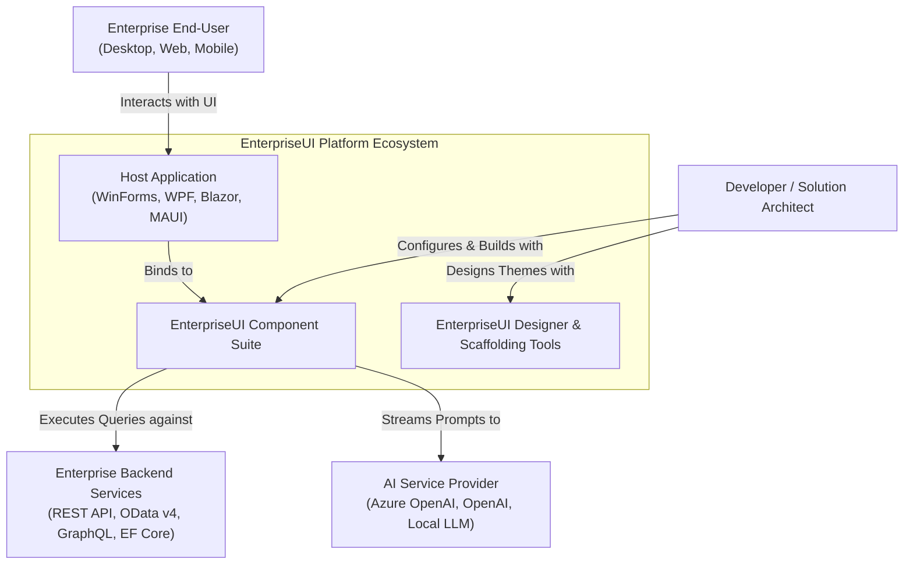
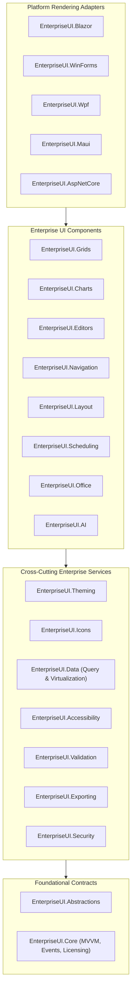
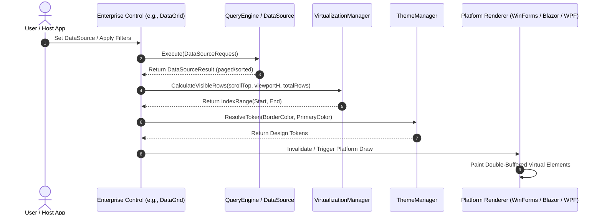
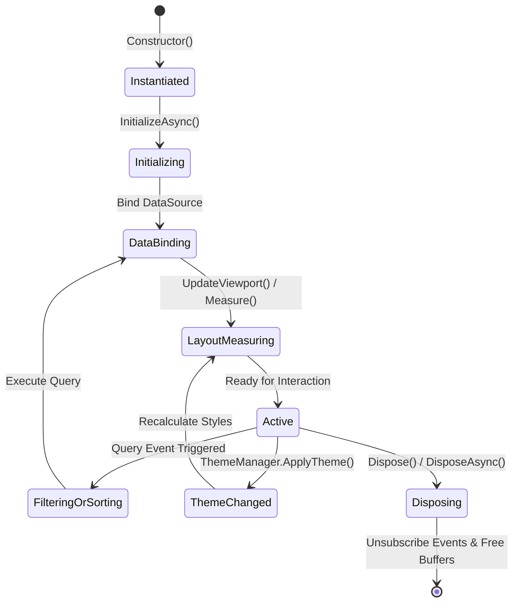

# EnterpriseUI Architecture & Systems Design Guide

## 1. Architectural Philosophy

EnterpriseUI is built from the ground up on modern .NET software engineering principles:

- **Clean Architecture & Domain Segregation**: UI rendering is strictly an infrastructure concern. Component state, query compilation, virtualization math, theme tokens, and accessibility are pure domain models.
- **Dependency Inversion**: Core components depend solely on abstractions (`IUIComponent`, `IInteractiveControl`, `IDataSource<T>`, `ITheme`, `IAccessibleControl`), never on platform-specific UI controls (like WinForms `Control`, WPF `DependencyObject`, or Blazor `ComponentBase`).
- **AOT & Trimming-Friendly**: Designed for Native AOT and trimming optimization with suppression attributes and statically analyzable property graphs.
- **Zero-Allocation Hot Paths**: The query engine and virtualization algorithms avoid per-frame allocations during scrolling and viewport updates.

---

## 2. C4 Architecture Models

### 2.1 Level 1: System Context EnterpriseDiagram

### 2.2 Level 2: Container EnterpriseDiagram (Layered Architecture)

---

## 3. Unified Rendering Pipeline

The rendering pipeline decouples component state and layout calculations from visual drawing:

---

## 4. Component Lifecycle Architecture

Every component in EnterpriseUI follows a deterministic lifecycle:

---

## 5. Extensibility & Inversion of Control

All components implement extensible interfaces allowing developers to swap any layer:

1. **Custom Data Providers**: Implement `IDataSource<T>` to hook into custom gRPC streams, Couchbase, or Elasticsearch.
2. **Custom Renderers**: Implement platform-specific renderers by consuming `RenderNode` or native paint events.
3. **Custom Theme Tokens**: Inherit existing tokens or register new design tokens with `ThemeBuilder`.
4. **Custom Validators**: Leverage fluent async rules with `Validator<T>.RuleForAsync(...)`.
5. **Security Gating**: Controls implement `IAuthorizedControl` to automatically hide or disable themselves based on current `ClaimsPrincipal` roles or permission sets.
