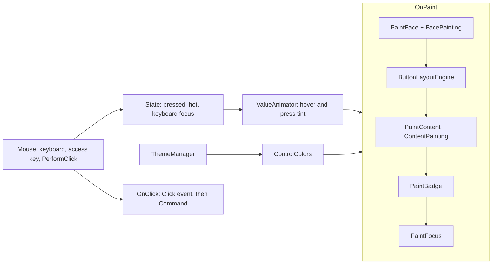

# Button

`EnterpriseButtonControl` is the themable push button of EnterpriseUI WinForms. It is one of four controls that share `EnterpriseButtonBase`:

| Control | Purpose |
|---|---|
| `EnterpriseButtonControl` | Push button; `DialogResult`, accept and cancel button of a form |
| `EnterpriseToggleButtonControl` | Latching button: two-state, three-state, exclusive groups |
| `EnterpriseSplitButtonControl` | Main action plus a drop-down menu opened from an arrow |
| `EnterpriseDropDownButtonControl` | Whole surface opens a menu |

See also: [feature comparison with a commercial reference button](ButtonFeatureComparison.md), [migration guide](ButtonMigrationGuide.md), [architecture](ButtonArchitecture.md) and the [implementation review](ButtonImplementationReview.md). The runnable page is **Interactive & AI Controls > Button Showcase** in the WinForms demo.

## Features

| Area | What you get |
|---|---|
| Appearance | Five variants (`Primary`, `Secondary`, `Success`, `Danger`, `Outline`), corner radius, color overrides (`FillColor`, `BorderColor`, `TextColor`), badge (`BadgeText`, `BadgeCount`) |
| Content | Text with access key, glyph, bitmap, `ImageList` image, or SVG; five arrangements (`ContentLayout`), `TextAlignment`, `ImageAlignment`, `DisplayStyle`, `TextWrap`, `ImageSize` |
| Sizing | `AutoSize` and `AutoSizeMode`, `GetPreferredSize`, DPI-scaled metrics, `Padding` |
| States | Normal, hot, pressed, disabled, keyboard focus; `VisualState`, `IsPressed`, `VisualStateChanged`; animated tints (`AnimateStates`) |
| Behavior | `ClickMode` (release, press, hover), `Command` and `CommandParameter`, `DialogResult`, `PerformClick()`, tooltips (`ToolTipText`, `ToolTipTextNeeded`) |
| Painting | `FacePainting` and `ContentPainting` events replace either part |
| Theming | Colors come from the active `ITheme`; runtime theme switching; Windows high contrast uses system colors |
| Accessibility | Role, name, keyboard shortcut, value, state and a working default action; Enter and Space; Alt+letter; focus ring |
| Design time | Smart tag (`ButtonActions`), categories and descriptions on every property, default event and property, `[ToolboxItem]`, designer serialization of `SvgImage` |
| Internationalization | `Text`, `Image` and `ToolTipText` are localizable; `RightToLeft` mirrors the layout |

## Architecture in one page



Details and sequence diagrams: [ButtonArchitecture.md](ButtonArchitecture.md).

## API reference

### Appearance

| Member | Type | Default | Notes |
|---|---|---|---|
| `Variant` | `EnterpriseButtonVariant` | `Primary` | `Outline` draws a border and tints on hover |
| `CornerRadius` | `int` | `4` | Logical pixels |
| `FillColor` | `Color` | empty | Replaces the variant color; the accent of `Outline` and unchecked toggles |
| `BorderColor` | `Color` | empty | Replaces the border color |
| `TextColor` | `Color` | empty | Replaces text and image color. All three overrides are ignored in high contrast mode |
| `BadgeText` / `BadgeCount` | `string?` / `int` | none / `0` | Text wins; count above 99 shows `99+` |
| `ShowFocusRing` | `bool` | `true` | Ring only appears for keyboard focus |
| `AnimateStates` | `bool` | `true` | Windows "animation effects" off always disables animation |

### Content

| Member | Type | Default | Notes |
|---|---|---|---|
| `Glyph` | `string?` | none | Symbol font character |
| `Image` | `Image?` | none | Fitted into `ImageSize`, proportions kept |
| `SvgImage` | `EnterpriseSvgImage?` | none | Painted in the state's text color; wins over `Glyph` and `Image` |
| `ImageList`, `ImageIndex`, `ImageKey` | | none, `-1`, `""` | Key wins over index |
| `ImageSize` | `Size` | empty (18 x 18) | Logical pixels |
| `DisplayStyle` | `ButtonDisplayStyle` | `ImageAndText` | `Text`, `Image`, `None` |
| `ContentLayout` | `ButtonContentLayout` | `ImageBeforeText` | `ImageAfterText`, `ImageAboveText`, `TextAboveImage`, `Overlay` |
| `TextImageRelation` | `TextImageRelation` | | The standard WinForms name of `ContentLayout` |
| `TextAlignment` | `ContentAlignment` | `MiddleCenter` | Position of the image and text block; of the text with `Overlay` |
| `ImageAlignment` | `ContentAlignment` | `MiddleCenter` | Position of the image with `Overlay` only |
| `TextWrap` | `bool` | `false` | Wraps instead of trimming with an ellipsis; no access key underline when wrapped |
| `UseMnemonic` | `bool` | `true` | `&Save` underlines S while Alt is held |

### Behavior and state

| Member | Notes |
|---|---|
| `ClickMode` | `Release` (default), `Press`, `Hover` |
| `Command`, `CommandParameter` | Executed after `Click`. While a command is set the button is enabled exactly while `CanExecute` allows it; removing the command restores the previous `Enabled` |
| `ToolTipText`, `ShowToolTips`, `ToolTipTextNeeded` | The event wins over the property; image-only buttons fall back to their text |
| `AutoSize`, `AutoSizeMode` | `GrowOnly` (default) or `GrowAndShrink` |
| `VisualState`, `IsPressed` | Read-only |
| `PerformClick()` | Clicks if enabled and visible |
| `ResolveToolTipText()` | The text that would show now |
| `DialogResult`, `IsDefault` | `EnterpriseButtonControl` only; implements `IButtonControl` |

### Events

`Click`, `FacePainting`, `ContentPainting`, `ToolTipTextNeeded`, `VisualStateChanged`. Toggle: `CheckStateChanging` (cancelable), `CheckedChanged`, `CheckStateChanged`. Split: `PrimaryActionClicked`, `DropDownOpening`, `DropDownClosed`, `MenuItemSelected`.

### `EnterpriseSvgImage`

```csharp
var fromPath = new EnterpriseSvgImage("M12 2a10 10 0 1 0 0 20a10 10 0 1 0 0-20z");     // 24 x 24 view box
var fromIcon = EnterpriseSvgImage.FromIcon(FluentIconPack.Save);
var fromMarkup = EnterpriseSvgImage.FromMarkup("<svg viewBox='0 0 24 24' fill='none' stroke='currentColor' stroke-width='2'><circle cx='12' cy='12' r='9'/><path d='M12 7v5l3 3'/></svg>");
image.Draw(graphics, bounds, color);       // any color, any size
using var bitmap = image.ToBitmap(32, Color.Black);
```

Supported: `path` (all commands: M L H V C S Q T A Z, absolute and relative), `rect` (with `rx`, `ry`), `circle`, `ellipse`, `line`, `polyline`, `polygon`; `fill`, `stroke`, `stroke-width`, `fill-rule` as attributes, in `style` or inherited from groups. Not supported: gradients, filters, text, transforms, `use`, per-shape colors (everything is painted in one color), DTDs (rejected to prevent entity expansion). Invalid input throws `ArgumentException`.

## Examples

### Basic and icons

```csharp
var save = new EnterpriseButtonControl { Text = "&Save", Glyph = "✔", Variant = EnterpriseButtonVariant.Success };
save.Click += (_, _) => Save();

var delete = new EnterpriseButtonControl
{
    Variant = EnterpriseButtonVariant.Danger,
    DisplayStyle = ButtonDisplayStyle.Image,
    SvgImage = EnterpriseSvgImage.FromIcon(FluentIconPack.Delete),
    ToolTipText = "Delete the selected item",      // also the accessible name
    Size = new Size(40, 36)
};
```

### Command

```csharp
var command = new RelayCommand(p => Export((string)p!), _ => HasRows);
var export = new EnterpriseButtonControl { Text = "Export", Command = command, CommandParameter = "pdf" };
// when HasRows changes:
command.RaiseCanExecuteChanged();    // may be called from any thread
```

### Auto size in a flow panel

```csharp
panel.Controls.Add(new EnterpriseButtonControl { Text = "Apply filters", AutoSize = true, AutoSizeMode = AutoSizeMode.GrowAndShrink });
```

### Custom painting

```csharp
button.FacePainting += (_, e) =>
{
    using var brush = new LinearGradientBrush(e.Bounds, Color.OrangeRed, Color.DeepPink, LinearGradientMode.Horizontal);
    using var path = Chrome.RoundedRect(e.Bounds, button.CornerRadius);
    e.Graphics.FillPath(brush, path);
    e.Handled = true;                    // skip the default face
};
```

### Dialog buttons

```csharp
var ok = new EnterpriseButtonControl { Text = "&OK", DialogResult = DialogResult.OK };
var cancel = new EnterpriseButtonControl { Text = "&Cancel", Variant = EnterpriseButtonVariant.Outline, DialogResult = DialogResult.Cancel };
form.AcceptButton = ok;
form.CancelButton = cancel;
```

### Guarded toggle

```csharp
toggle.CheckStateChanging += (_, e) => e.Cancel = isLocked;    // e.OldState, e.NewState
```

## Best practices

- Give every icon-only button a `ToolTipText`: it is the tooltip and the accessible name.
- Prefer `SvgImage` to bitmaps: it follows the theme and is sharp at every DPI.
- Bind actions with `Command` so the enabled state follows the model; do not set `Enabled` while a command is attached.
- Use `Variant` for meaning (`Danger`) and the color overrides only for brand colors; overrides are ignored in high contrast mode by design.
- Use `AutoSize` instead of measuring text yourself.
- Do not subscribe to `MouseUp` to detect clicks; use `Click`, so keyboard, access keys, `PerformClick` and accessibility clients also work.
- Keep `UseMnemonic` on for commands that users reach with the keyboard and avoid duplicate access keys on one screen.

## Behavior notes

- Enter and Space click once per key press; holding the key does not repeat the click.
- The focus ring appears for keyboard focus (Tab, arrow keys) and not after a mouse click.
- Disabled buttons ignore mouse, keyboard and access keys and are painted dimmed (SVG in the disabled color, bitmaps in grayscale).
- `GetPreferredSize` includes the badge and, for split buttons, the arrow.
