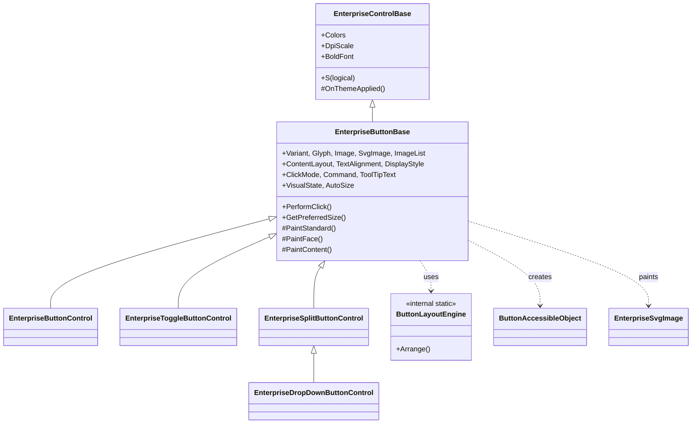
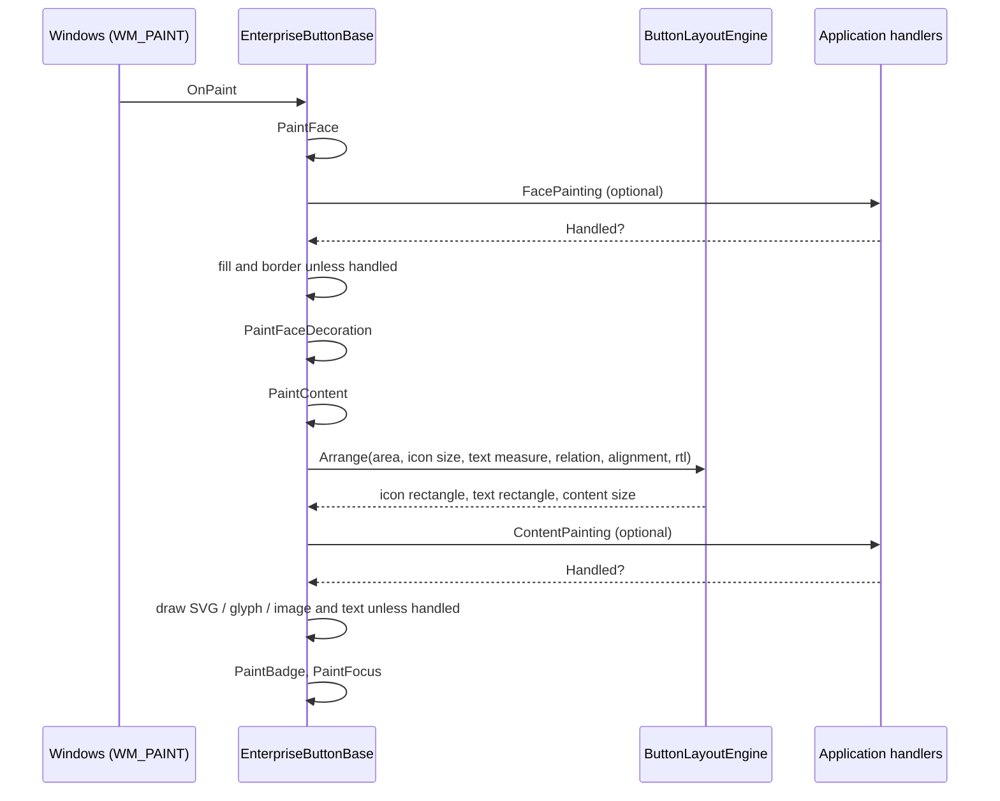
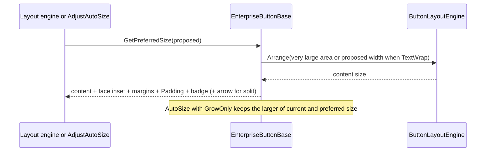
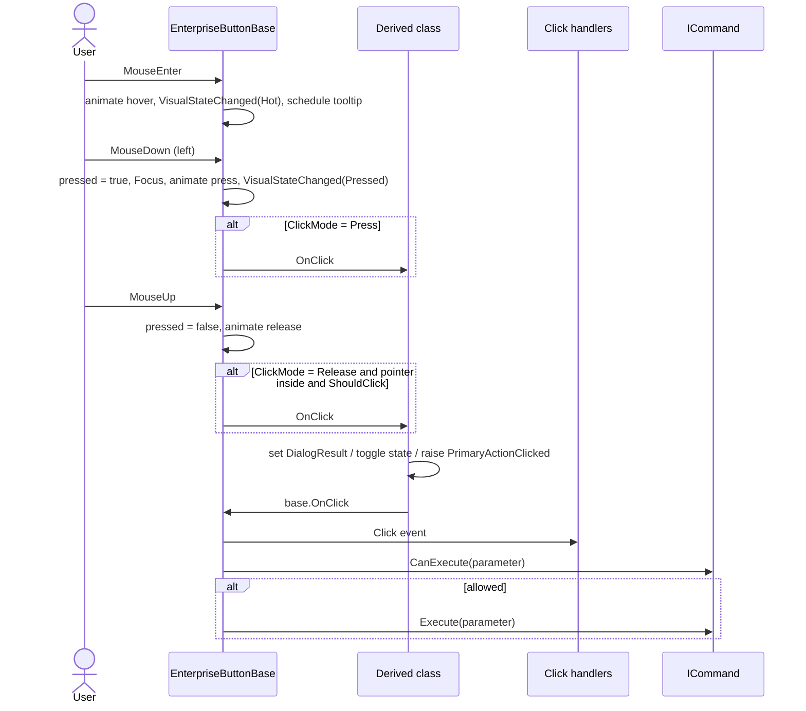
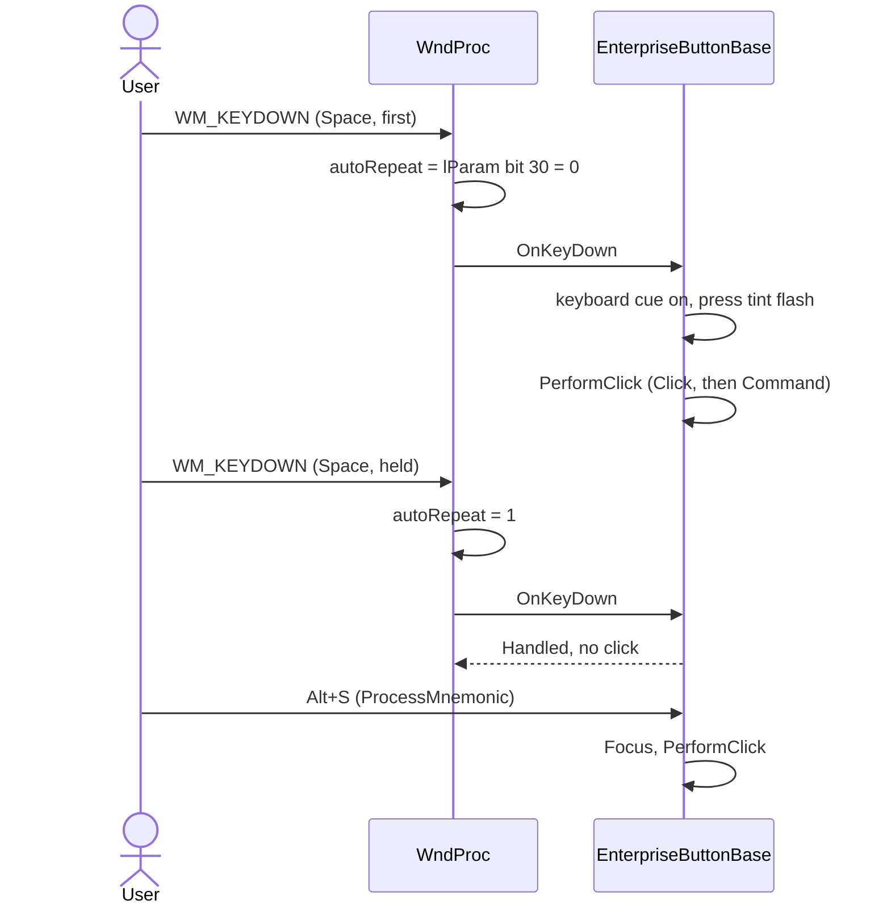
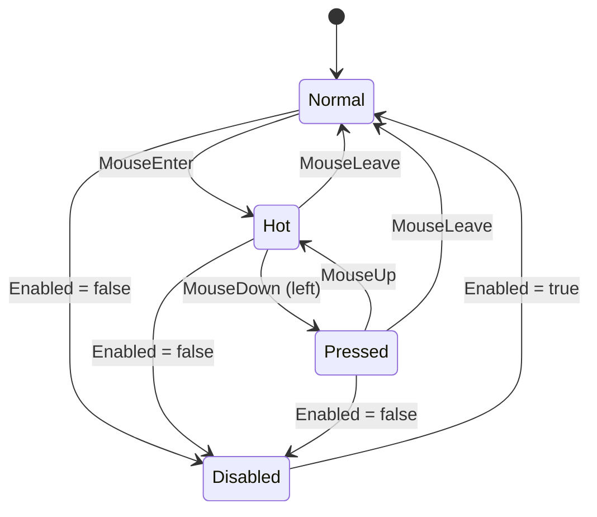
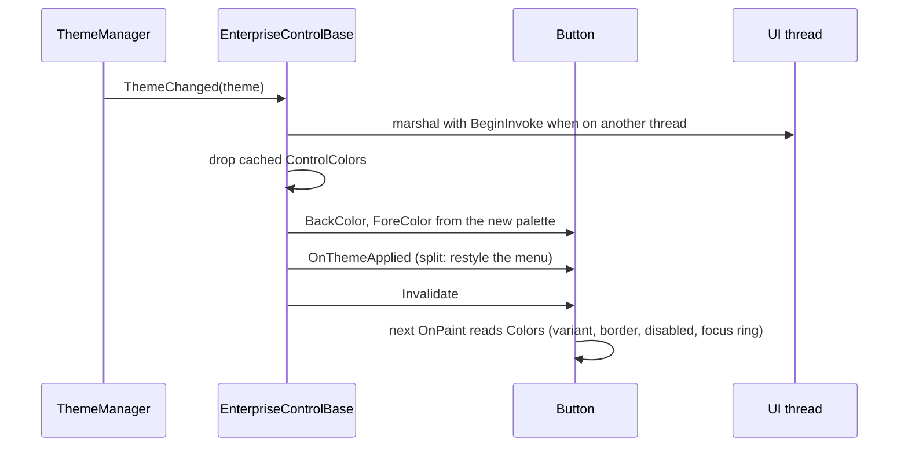
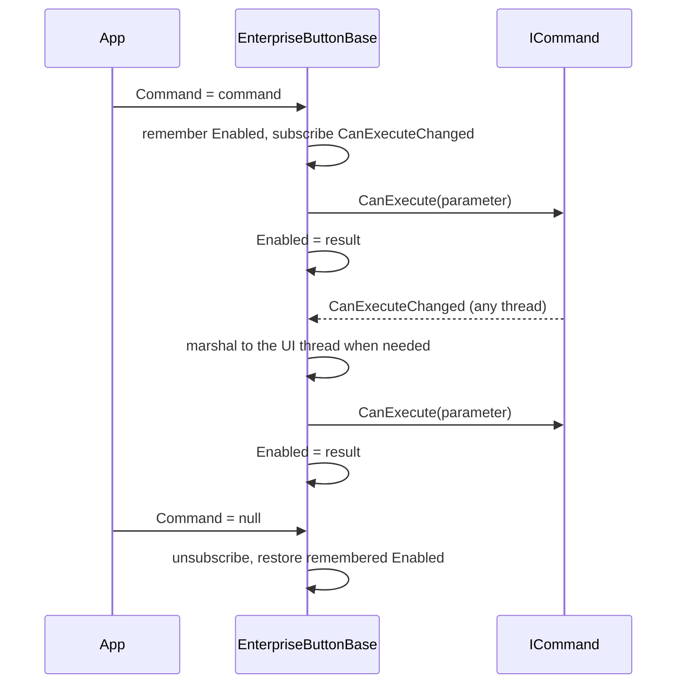
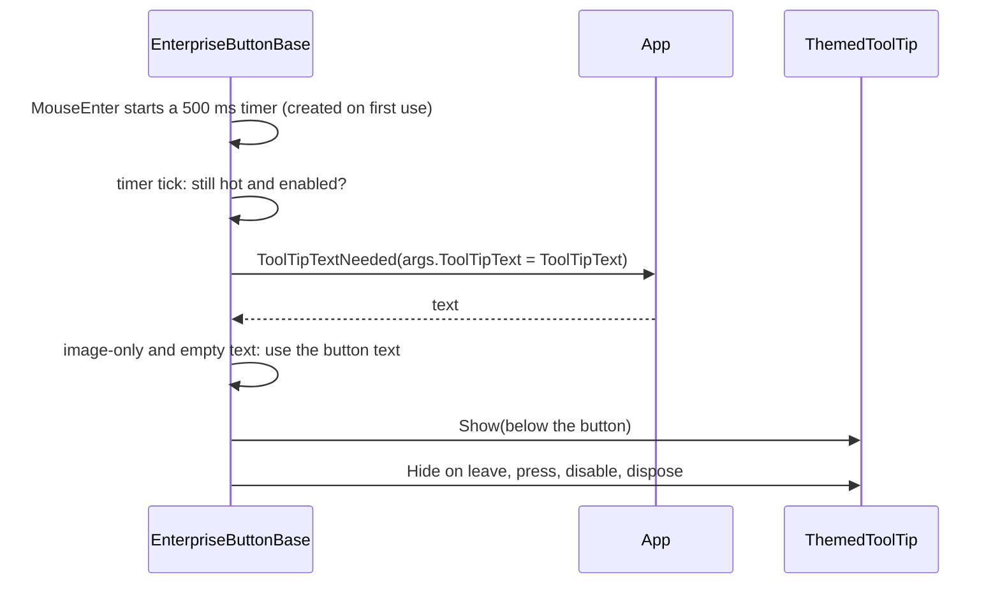
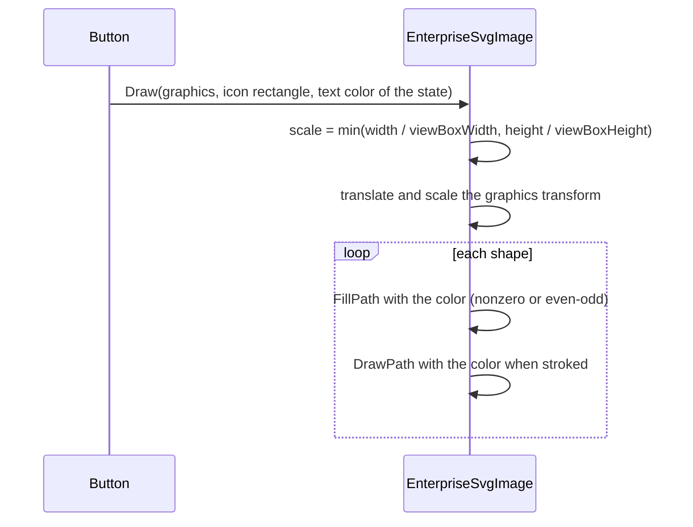

# Button architecture

Internals of the button family in `EnterpriseUI.WinForms`. API: [Button.md](Button.md).

## Class structure

| Piece | File | Responsibility |
|---|---|---|
| `EnterpriseButtonBase` | `Interactivity/EnterpriseButtonBase.cs` | State, input, painting steps, command, tooltip, sizing, accessibility hooks |
| `ButtonLayoutEngine` | `Interactivity/EnterpriseButtonSupport.cs` | Pure arrangement of image and text for a rectangle; used by painting and by `GetPreferredSize` |
| `ButtonAccessibleObject` | same | Name, value, shortcut, state, default action |
| `EnterpriseSvgImage`, `SvgPathParser` | `Interactivity/EnterpriseSvgImage.cs` | SVG path and markup to `GraphicsPath`, drawing in one color |
| `ButtonActions` | `Design/EnterpriseDesigners.cs` | Smart tag |
| Derived controls | `Interactivity/EnterpriseButtons.cs` | Dialog result, toggle state, split and drop-down menu |

## Rendering pipeline

`OnPaint` calls `PaintStandard` (toggle and split controls have their own `OnPaint` that calls the same steps):

1. Clear with the parent's back color.
2. `PaintFace`: raises `FacePainting`; if not handled fills the rounded face (variant color blended with white for hover and black for pressed, using the animator values) and draws the border (width scaled by DPI, radius scaled by DPI).
3. `PaintFaceDecoration`: default-button marker of `EnterpriseButtonControl`.
4. `PaintContent`: asks `ButtonLayoutEngine.Arrange` for the image and text rectangles, raises `ContentPainting`; if not handled draws the SVG, glyph or image, then the text with the access key underline.
5. `PaintBadge`, then `PaintFocus` (ring only for keyboard focus).

Text is parsed (access key) and measured once per text or font change and cached; the glyph size is cached per glyph and font size; the disabled-image color matrix is created once.

## Sizing

All numbers are logical values passed through `S()`, which multiplies by `DeviceDpi / 96`.

## Click processing (mouse)

`ClickMode.Hover` raises `OnClick` from `OnMouseEnter`. `ShouldClick` lets the split button ignore releases over its arrow.

## Keyboard interaction

Enter and Space are declared input keys so dialogs do not steal them. The auto-repeat flag is read in `WndProc` because `KeyEventArgs` does not carry it.

## State transitions

`VisualState` is derived: `Disabled` if not enabled, else `Pressed`, else `Hot` (pointer inside), else `Normal`. `VisualStateChanged` fires after each input handler when the derived value changed. Keyboard focus is independent: it only decides whether the focus ring is drawn.

## Theme application

In Windows high contrast mode `ControlColors` returns system colors and the button ignores `FillColor`, `BorderColor` and `TextColor`.

## Command binding

## Tooltip

## SVG drawing

The `GraphicsPath` objects are built once when the image is created; drawing only changes the graphics transform, so painting does not allocate paths.

## Event model

| Event | Raised from | Notes |
|---|---|---|
| `Click` | `OnClick` | Mouse, `Press` or `Hover` mode, Enter, Space, access key, `PerformClick`, accessibility default action |
| `VisualStateChanged` | Mouse and enabled handlers | After the state changed |
| `FacePainting`, `ContentPainting` | `OnPaint` | Only allocated and raised when subscribed |
| `ToolTipTextNeeded` | Tooltip timer | And from `ResolveToolTipText()` |
| `CheckStateChanging` | Toggle `CheckState` setter | Cancelable; not raised for group members that are unchecked by another member |
| `CheckStateChanged`, `CheckedChanged` | After the change | |

## Design-time model

`EnterpriseButtonBase` carries `[ToolboxItem]`, `[DefaultEvent(Click)]`, `[DefaultProperty(Text)]` and `[Designer(EnterpriseControlDesigner<ButtonActions>)]`. `ButtonActions` reads and writes through `TypeDescriptor`, so smart tag edits are undoable. Properties have `[Category]`, `[Description]` and `[DefaultValue]`; `Command` and `CommandParameter` are hidden from the designer; `SvgImage` serializes through `EnterpriseSvgImageConverter` (`InstanceDescriptor`) and can be typed as path data or markup in the property grid.
