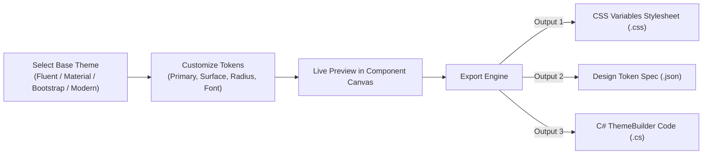

# EnterpriseUI Tooling & Designers Guide

EnterpriseUI includes a suite of developer productivity tools designed to accelerate design-to-production workflows:

```
tooling/
├── EnterpriseUI.ThemeDesigner     # Interactive Theme Customizer & Token Exporter
├── EnterpriseUI.VisualDesigner    # Design-Time Surface & Toolbox Registration
├── EnterpriseUI.TemplateStudio    # CRUD & Dashboard Scaffolding Engine
└── EnterpriseUI.CodeGenerators    # Roslyn Source Generators & Metadata Reflection
```

---

## 1. Theme Designer (`EnterpriseUI.ThemeDesigner`)

The Theme Designer enables designers and frontend engineers to customize brand colors, typography, borders, and shadows visually, exporting production-ready assets:



### Programmatic Usage
```csharp
using EnterpriseUI.ThemeDesigner;

var designer = new ThemeDesignerEngine();
designer.UpdateToken("primary", "#e65100");
designer.UpdateToken("border-radius", "8px");

var result = designer.Export();
Console.WriteLine(result.CssVariables);
Console.WriteLine(result.CSharpBuilderCode);
```

---

## 2. Visual Designer & Toolbox (`EnterpriseUI.VisualDesigner`)

Enables Visual Studio and design-time IDE surfaces to reflect component properties and populate the developer toolbox:

```csharp
using EnterpriseUI.VisualDesigner;
using EnterpriseUI.Grids;
using EnterpriseUI.Charts;

// Register custom controls into the visual designer toolbox
ToolboxService.Register("DataGrid", "Data & Grids", typeof(DataGrid<>), "High-performance virtualized grid");
ToolboxService.Register("EnterpriseChart", "Visualization", typeof(EnterpriseChart), "Multi-series business charts");

// Inspect registered tools
foreach (var tool in ToolboxService.Items)
{
    Console.WriteLine($"[{tool.Category}] {tool.Name}: {tool.Description}");
}
```

---

## 3. Template Studio (`EnterpriseUI.TemplateStudio`)

Automates scaffolding complete enterprise views and view models:

Supported Scaffolding Templates:
- `TemplateType.DataGridCrudView`: Scaffolds a complete virtualized DataGrid with sorting, filtering, and paging.
- `TemplateType.ExecutiveDashboard`: Generates a responsive 4-column KPI dashboard.
- `TemplateType.SchedulerBookingApp`: Scaffolds calendar appointments and resource grouping.
- `TemplateType.DocumentPortal`: Scaffolds PDF/Office document viewer workflows.

```csharp
using EnterpriseUI.TemplateStudio;

string generatedSource = TemplateStudioEngine.GenerateTemplateCode(
    TemplateType.DataGridCrudView, 
    "CustomerOrder"
);
```

---

## 4. Roslyn Code Generators (`EnterpriseUI.CodeGenerators`)

Eliminates boilerplate dependency injection registration by automatically discovering all EnterpriseUI components at compile time:

```csharp
using EnterpriseUI.CodeGenerators;

// Emits clean Microsoft.Extensions.DependencyInjection extension methods
var source = ComponentCodeGenerator.GenerateRegistrationSource(new[]
{
    "DataGrid<CustomerOrder>",
    "ThemeManager",
    "ToastService",
    "EnterpriseAIAssistant"
});
```
Emitted code:
```csharp
// <auto-generated/>
using Microsoft.Extensions.DependencyInjection;

public static class EnterpriseUIServiceCollectionExtensions
{
    public static IServiceCollection AddEnterpriseUI(this IServiceCollection services)
    {
        services.AddTransient<DataGrid<CustomerOrder>>();
        services.AddTransient<ThemeManager>();
        services.AddTransient<ToastService>();
        services.AddTransient<EnterpriseAIAssistant>();
        return services;
    }
}
```
