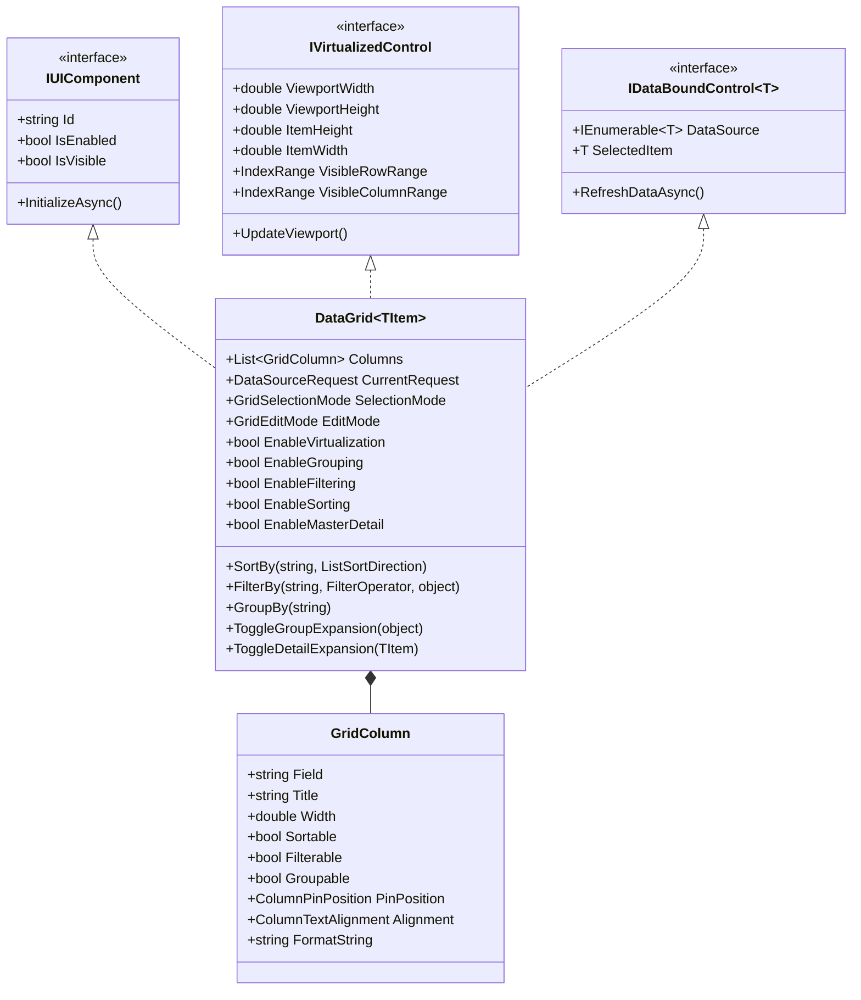

# EnterpriseUI Grid Architecture & Feature Guide

The **EnterpriseUI DataGrid** is the centerpiece of the component library, uniting the capabilities of **reference RadGridView** and **legacy GridControl** into an uncompromising high-performance component.

---

## 1. Grid Ecosystem Overview

The `EnterpriseUI.Grids` package contains three unified controls:

1. **`DataGrid<T>`**: High-density tabular data grid supporting 2D virtualization, multi-column sorting, Excel-style filtering, multi-level grouping with aggregates, master-detail hierarchy, and cell/row editing.
2. **`EnterpriseTreeList<T>`**: Hierarchical self-referencing and parent-child grid combining tree navigation with multi-column tabular representation.
3. **`EnterprisePivotGrid<T>`**: Multi-dimensional OLAP cross-tabulation engine for dynamic aggregation across Row, Column, Data, and Filter dimensions.

---

## 2. DataGrid Feature Matrix


---

## 3. Class EnterpriseDiagram & Architecture



---

## 4. Column Types & Configuration

Columns are configured declaratively or dynamically:

```csharp
var grid = new DataGrid<Invoice>();

// 1. Text Column with Custom Alignment
grid.Columns.Add(new GridColumn 
{ 
    Field = "InvoiceNumber", 
    Title = "Invoice #", 
    Width = 120,
    PinPosition = ColumnPinPosition.Left // Freezes column on scroll
});

// 2. Numeric Column with Formatting
grid.Columns.Add(new GridColumn 
{ 
    Field = "Subtotal", 
    Title = "Amount", 
    FormatString = "C2", 
    Alignment = ColumnTextAlignment.Right,
    Width = 140 
});

// 3. Date Column
grid.Columns.Add(new GridColumn 
{ 
    Field = "DueDate", 
    Title = "Due Date", 
    FormatString = "yyyy-MM-dd", 
    Width = 130 
});

// 4. Command Action Column
grid.Columns.Add(new GridCommandColumn 
{ 
    Title = "Actions", 
    Width = 100, 
    PinPosition = ColumnPinPosition.Right 
});
```

---

## 5. Sorting, Filtering, and Grouping

### Dynamic Sorting
```csharp
// Programmatic sorting
grid.SortBy("Subtotal", ListSortDirection.Descending);
```

### Expression-Based Filtering
Filters can be applied directly using any of the 14 `FilterOperator` values:
```csharp
// Filter: Subtotal >= 5000 AND CustomerName contains "Acme"
grid.FilterBy("Subtotal", FilterOperator.IsGreaterThanOrEqualTo, 5000m);
grid.FilterBy("CustomerName", FilterOperator.Contains, "Acme");
```

### Grouping with Aggregations
```csharp
// Group rows by Region and calculate automatic count/sum
grid.GroupBy("Region");
```
When grouped, rows can be expanded or collapsed interactively:
```csharp
grid.ToggleGroupExpansion("North America");
```

### Conditional Formatting

The WinForms renderer supports cell highlights, numeric color scales, and bounded numeric data bars through `GridFormatRule`. Data-bar and color-scale rules require numeric `Value1` and `Value2` bounds; values outside the range are clamped to the nearest endpoint. Highlight rules support equality and comparison operators, including `Between`.

```csharp
grid.FormatRules.Add(new GridFormatRule
{
    Name = "Revenue data bar",
    ColumnField = "Revenue",
    RuleType = FormatRuleType.DataBar,
    Value1 = 0m,
    Value2 = 100000m,
    BackgroundColorHex = "#5088d7"
});

grid.FormatRules.Add(new GridFormatRule
{
    Name = "Over target",
    ColumnField = "Revenue",
    RuleType = FormatRuleType.HighlightCell,
    Operator = FormatConditionOperator.GreaterThanOrEqual,
    Value1 = 75000m,
    BackgroundColorHex = "#d8f0df"
});
```

Top-N/Bottom-N rules and icon-set rendering are not implemented. Data-bar and color-scale bounds must be supplied explicitly; the renderer does not scan the full data source during painting.

---

## 6. Master-Detail Hierarchy

To enable hierarchical drill-down into child records (e.g., an Order displaying its Line Items):

```csharp
grid.EnableMasterDetail = true;
grid.ToggleDetailExpansion(selectedOrder);

if (grid.IsDetailExpanded(selectedOrder))
{
    // Renders nested detail template
}
```
