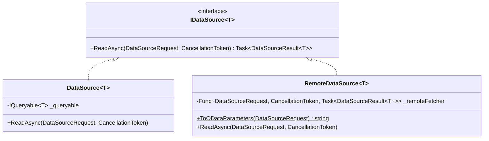

# DataGrid Data Binding & Editing Guide

## 1. Data Binding Abstraction

EnterpriseUI provides a unified `IDataSource<T>` contract that abstracts data retrieval across in-memory collections, ORMs, and remote network endpoints.



---

## 2. In-Memory & EF Core Binding

Binding to local memory collections or Entity Framework Core queryables is instantaneous:

```csharp
// In-Memory List
var customers = new List<Customer> { /* ... */ };
grid.DataSource = customers;

// Entity Framework Core DbContext Queryable
using var db = new AppDbContext();
grid.CustomDataSource = new DataSource<Customer>(db.Customers.AsNoTracking());
await grid.RefreshDataAsync();
```

---

## 3. Remote Data & OData v4 Integration

When binding to remote microservices, `RemoteDataSource<T>` translates `DataSourceRequest` (page, page size, filters, sorts) directly into standardized OData v4 query parameters:

```csharp
grid.CustomDataSource = new RemoteDataSource<CustomerOrder>(async (request, cancellationToken) =>
{
    using var client = new HttpClient { BaseAddress = new Uri("https://api.enterprise.com/") };
    
    // Automatically generate $top, $skip, $orderby, $filter, $count
    var odataQuery = RemoteDataSource<CustomerOrder>.ToODataParameters(request);
    var response = await client.GetFromJsonAsync<ODataEnvelope<CustomerOrder>>($"api/orders?{odataQuery}", cancellationToken);

    return new DataSourceResult<CustomerOrder>
    {
        Data = response.Value,
        Total = response.Count
    };
});
```

---

## 4. Editing Modes

EnterpriseUI DataGrid supports 5 distinct editing paradigms:

| Mode | Enum Value | Description | Typical Use Case |
|---|---|---|---|
| **None** | `GridEditMode.None` | Read-only mode with selection support. | Reporting & dashboards |
| **In-Cell** | `GridEditMode.InCell` | Click any cell to enter inline editing with immediate or blur commit. | Financial trading grids |
| **Inline Row** | `GridEditMode.InlineRow` | Puts the entire row into edit mode with Save / Cancel action buttons. | CRUD administration |
| **Popup Modal** | `GridEditMode.PopupModal` | Opens a centered modal dialog containing the form fields for the record. | Dense entities with 20+ fields |
| **Batch** | `GridEditMode.Batch` | Multiple cells across multiple rows can be modified before committing a bulk save. | Bulk data entry |

### Configuring In-Cell Editing
```csharp
grid.EditMode = GridEditMode.InCell;
```

---

## 5. Validation Integration

Integrate `Validator<T>` from `EnterpriseUI.Validation` to enforce business rules before committing edits:

```csharp
var validator = new Validator<CustomerOrder>();

validator.RuleFor(x => x.TotalAmount, amount => amount > 0, "Amount must be greater than zero.");
validator.RuleFor(x => x.CustomerName, name => !string.IsNullOrWhiteSpace(name), "Customer name is required.");

// Async remote validation rule (e.g., check credit limit)
validator.RuleForAsync(x => x.TotalAmount, async (amount, ct) =>
{
    return await CreditService.CheckLimitAsync(amount, ct);
}, "Order exceeds customer credit limit.");
```
