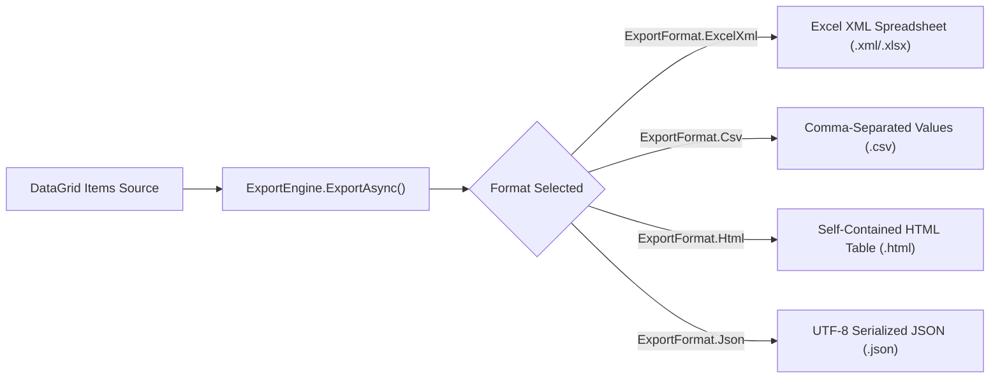

# DataGrid Exporting, Security & Accessibility Guide

## 1. Streaming Multi-Format Exporting

EnterpriseUI provides streaming exporters via `EnterpriseUI.Exporting.ExportEngine` that write directly to the target output stream without loading full documents into RAM.



### Export Code Example
```csharp
using EnterpriseUI.Exporting;

// Export currently rendered grid items directly to a file stream
using var fileStream = File.Create("C:\\Exports\\OrdersReport.xlsx");
await ExportEngine.ExportAsync(grid.RenderedItems, ExportFormat.ExcelXml, fileStream);
```

---

## 2. Field-Level Security & Authorization

To protect sensitive data columns (such as Salaries, SSNs, or Internal Cost Centers), EnterpriseUI integrates with `EnterpriseUI.Security`:

```csharp
using EnterpriseUI.Security;

// Check user permissions before exposing restricted columns
if (SecurityManager.Instance.HasPermission("Payroll.ViewSalary"))
{
    grid.Columns.Add(new GridColumn 
    { 
        Field = "BaseSalary", 
        Title = "Base Salary", 
        FormatString = "C0" 
    });
}
```

Controls implementing `IAuthorizedControl` automatically evaluate `SecurityManager.Instance.CurrentPrincipal`:
```csharp
public class SecureActionColumn : GridColumn, IAuthorizedControl
{
    public string? RequiredPermission { get; set; } = "Orders.Delete";
    public string? RequiredRole { get; set; } = "Administrator";
    public bool IsAuthorized => SecurityManager.Instance.Authorize(RequiredRole, RequiredPermission);
}
```

---

## 3. Accessibility & WCAG 2.2 AA Compliance

EnterpriseUI DataGrid is designed accessibility-first:

- **ARIA Semantics**: Implements `role="grid"`, with child rows having `role="row"` and cells having `role="gridcell"`.
- **Roving TabIndex**: Only the active cell has `tabindex="0"`; all other cells receive `tabindex="-1"`.
- **Screen Reader Announcements**: Sorting and filtering actions trigger dynamic polite live region announcements:
  ```csharp
  AccessibilityManager.Instance.Announce("Grid sorted by TotalAmount descending", LiveRegionPoliteness.Polite);
  ```

### Standard Keyboard Navigation Contract

| Key Combination | Action |
|---|---|
| <kbd>Arrow Left</kbd> / <kbd>Arrow Right</kbd> | Move active focus to preceding or following cell. |
| <kbd>Arrow Up</kbd> / <kbd>Arrow Down</kbd> | Move active focus to row above or below. |
| <kbd>Home</kbd> / <kbd>End</kbd> | Navigate to the first cell or last cell in the current row. |
| <kbd>Ctrl</kbd> + <kbd>Home</kbd> | Navigate to the very first cell of the first row in the grid. |
| <kbd>Ctrl</kbd> + <kbd>End</kbd> | Navigate to the very last cell of the last row in the grid. |
| <kbd>Page Up</kbd> / <kbd>Page Down</kbd> | Scroll viewport up or down by one full page height and shift focus. |
| <kbd>Space</kbd> | Toggle checkbox selection on the focused row. |
| <kbd>Enter</kbd> | Enter In-Cell edit mode; submit edit on second press. |
| <kbd>Escape</kbd> | Cancel current edit without committing changes. |
