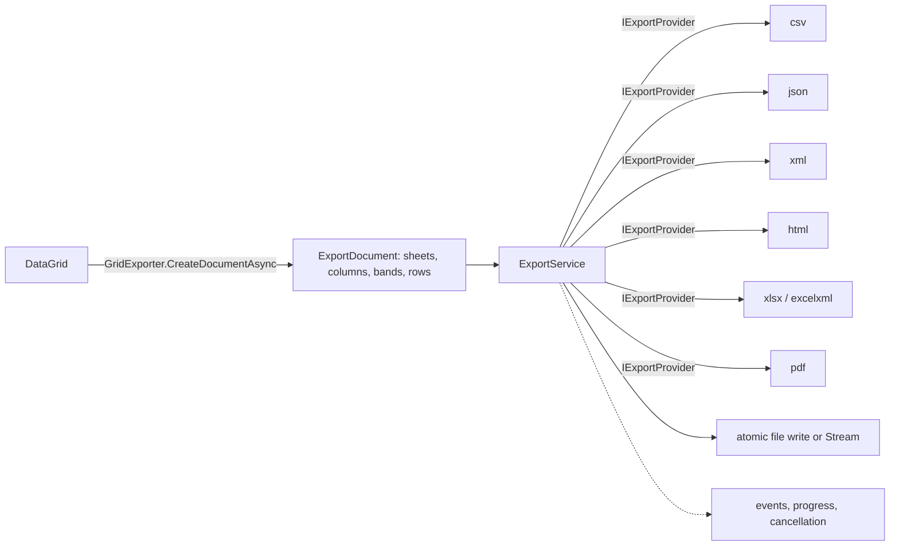

# 6. Exporting architecture

## Model

`ExportDocument` holds `ExportSheet`s. A sheet has `ExportColumn`s (key, title, width, alignment, format, data type, band path), a lazy `IEnumerable<ExportRow>` and optional footer rows and conditional formats. `ExportRow.Kind` is Data, GroupHeader, GroupFooter, DetailHeader, DetailData or Summary, with `Level`, `OutlineLevel`, cell styles, group key and aggregates.

## Service

`ExportService` registers providers (ids `csv`, `json`, `xml`, `html`, `xlsx`, `excelxml`, `pdf`), pumps rows through the provider, raises `Started`, `RowExporting`, `CellExporting` and `Completed`, reports `ExportProgress` and honors a `CancellationToken`. `ExportToFileAsync` writes to a temporary file and renames it on success, so a failed or cancelled export leaves nothing behind.

## Providers

| Id | Notes |
|---|---|
| csv | delimiter and quoting options; formula-injection sanitizing on by default |
| json | indented or compact; groups and details as nested arrays |
| xml | element per row; schema-friendly names |
| html | semantic table, header cells, group rows |
| xlsx | real OOXML (zip, worksheet XML, styles, shared formats); outline levels, frozen header, auto filter, conditional formats |
| excelxml | SpreadsheetML 2003 |
| pdf | streamed PDF 1.4 with xref offsets; fit-to-width, repeated header, header/footer text; standard Latin fonts |

## Grid adapter options (`GridExportOptions`)

Title, sheet name, visible columns only, current page only, groups, hierarchy (nested or one sheet per relation), summaries, conditional formatting, bands, max rows.

## Security and robustness

- CSV cells starting with `=`, `+`, `-`, `@` are prefixed so spreadsheets do not execute them.
- XML and HTML output is escaped; invalid XML characters are removed.
- Files are written atomically; exports are cancellable and report progress.

## Known limits

- PDF uses standard fonts (Latin text); other scripts are not faithfully rendered.
- No Word or image export.
