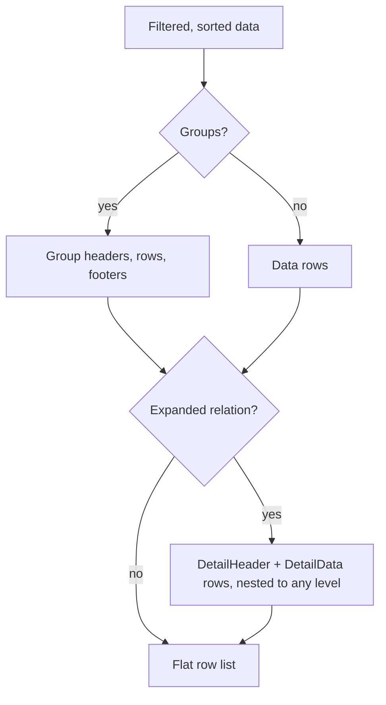

# 5. Hierarchy architecture

## Model

`GridHierarchyRelation` joins child items to a parent row:

| Property | Meaning |
|---|---|
| `RelationName`, `Title` | label of the child table |
| `KeyField` / `ForeignField` | parent key property and child foreign key property |
| `Mode` | `MasterDetail`, `SelfReferencing` (tree) or `TabbedDetail` (modelled, drawn as sequential blocks) |
| `ChildSource` | complete child table joined by key |
| `DetailItemsSelector` | resolve children from the parent object (wins over `ChildSource`) |
| `LoadChildrenAsync` | lazy loading on first expansion |
| `ChildColumns` | columns of the child table; generated from the child type when empty (foreign key omitted, date and number defaults) |
| `ChildRelations` | further levels, unlimited depth |

## Row model

The engine exposes one flat list of display rows. `TryGetRowAt(index)` returns a `GridRow<T>` whose `Kind` is `Data`, `GroupHeader`, `GroupFooter`, `DetailHeader`, `DetailData` or `DetailSummary`, with `Level`, `IsExpandable`, `IsExpanded`, `IsLoading`, `Relation`, `Parent` and `RowObject`.

When groups, a self-reference relation or expanded details exist, the engine materializes a compact row-reference array (`RowRef`); otherwise it uses the windowed mode. `MaxMaterializedRows` (default 2,000,000) bounds the array.

## Tree (self-reference)

`AddSelfReference(keyField, parentField)` builds the tree from parent keys: siblings follow the active sort, filters keep the ancestors of matches, rows whose parent is missing become roots, and cyclic parent chains are broken where they repeat. `ToggleTreeNode`, `ExpandAllTreeNodes`, `CollapseAllTreeNodes`, `TreeExpandedByDefault`.

## Lazy loading

A relation with `LoadChildrenAsync` shows a loading header on first expansion, caches the result until the grid refreshes and cancels the load when the grid is disposed or the query changes.

## Cross-feature behavior

- Search can include child tables and expand groups, tree nodes and details that contain a match.
- Export writes child rows nested under their parent (outline levels) or as separate sheets with a Parent column.
- Print and accessibility see the same rows as the screen: detail rows are labelled by relation title and level and expose expanded state.

## Known limits

- Child tables are rows of the parent grid, not independent grids; they have no own sorting, editing or selection model.
- `TabbedDetail` is not drawn as tabs.
