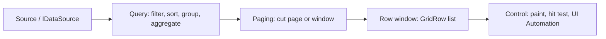

# 4. Paging architecture

## Modes

| Mode | Query sent to the source | Navigation UI | Typical use |
|---|---|---|---|
| None | whole result, rows fetched as the user scrolls | none | small and medium lists |
| Client | whole result read once, cut into pages in memory | pager bar | fast navigation over data that fits memory |
| Server | `skip`/`take` for one page plus the total | pager bar | remote or very large sources |
| Virtual | page-aligned windows while scrolling | none (scrollbar) | very large sources, continuous reading |
| Infinite | pages appended on demand | Load more button and scroll trigger | feeds and logs |

## Pipeline

Paging is applied after filtering, sorting and grouping, so page counts, totals, summaries and group aggregates always describe the whole result. `TotalRecordCount` is the full filtered count; `TotalItemsCount` is the number of display rows on the current page (which includes group and detail rows).

## Components

- `DataGrid<T>.PagingMode`, `PageSize`, `PageIndex`, `PageCount`, `GoToPage`, `FirstPage` ... `LastPage`, `SetPageSize`, `LoadMoreAsync`, `PageChanged`, `PagerText`, `GridPagingHelper.GetPageButtons` (the page number window with ellipsis).
- Server paging reads `DataSourceRequest.EffectiveSkip`/`EffectiveTake` in the data source; `RemoteDataSource<T>` wraps a delegate; `ODataQueryBuilder` translates a request to `$skip/$top/$filter/$orderby`.
- The WinForms control draws the pager (first, previous, numbered buttons, next, last, rows-per-page menu, status text) and routes clicks; Ctrl+PageUp/PageDown change page; every change raises an announcement ("Page 3 of 10").

## Behavior rules

- A query change (sort, filter, group, search) returns to page 1; a page change clears selection and collapses nothing else.
- Stale responses are dropped: each load carries a version and a cancelled or superseded request never overwrites a newer result.
- Grouping with paging groups the full result, then pages the flattened row list.

## Known limits

- Client mode holds one materialized query result.
- Page sizes come from `PageSizeOptions` (default 10, 25, 50, 100).
- The pager is drawn, not a child control; it is reachable by keyboard shortcuts and announced, and is not an individual UI Automation element.
