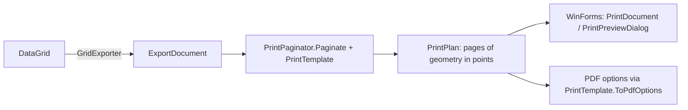

# 7. Printing architecture

## Separation

Pagination is pure: `PrintPaginator.Paginate(document, template)` returns `PrintPage`s with the column slice (`FirstColumn`, `ColumnCount`), `Scale`, whether the header repeats and `PlacedRow`s with a y position and height in points. Nothing in it touches GDI+, so it is unit tested (paper sizes, scaling, repeated headers, column splitting, page order, truncation, banded headers).

## Settings

`PrintPageSettings`: paper size (Letter, Legal, Tabloid, A3, A4, A5), landscape, margins, scale mode (None, FitToWidth, FitToPage, Percent), scale percent, font size, repeat header rows, grid lines, page order (down then over, over then down), max rows.
`PrintTemplate`: title, header and footer left/center/right text with tokens `{title}`, `{date}`, `{page}`, `{pages}`, plus a `PrintStyle` (header, band, group, summary and grid-line colors, alternate rows). Presets: Standard, LandscapeReport, Compact (`PrintTemplateRegistry`).

## Rendering (WinForms)

`EnterpriseDataGrid<T>.CreatePrintPlanAsync`, `ShowPrintPreviewDialogAsync`, `PrintAsync`, `ShowPageSetupDialog`. The renderer scales the Graphics to points, draws header and footer bands, header rows (band levels then column titles), then rows by kind (group rows span the table; data rows use cell styles, alternate shading and alignment). Page setup maps back to the template (orientation, margins, nearest paper size).

## Behavior notes

- The whole current query result is printed (up to `MaxRows`, default 5,000 in the Standard template); selected-only printing is not available.
- Fit to width shrinks columns uniformly down to 20%; below that, columns continue on additional pages.

## Known limits

- Printing relies on the Windows print stack; with no printer installed the dialogs report it instead of failing.
- Child tables print as rows under their parent; there is no separate child-table print layout.
