# EnterpriseUI: Unified Component Ecosystem Documentation

Welcome to the official technical documentation for **EnterpriseUI**, the commercial-grade .NET 8+ UI framework and component platform.

---

## Documentation Information Architecture

```
docs/
├── Introduction/              # Product overview, value proposition, vendor parity matrix
├── GettingStarted/           # 5-minute onboarding across Blazor, WinForms, WPF, MAUI
├── Architecture/             # C4 models, rendering engine, platform bridges, lifecycle
├── Grid/                     # Dedicated DataGrid, EnterpriseTreeList & EnterprisePivotGrid architecture guides
├── Controls/                 # Complete unified component catalog & API reference
├── Themes/                   # Theming system, design tokens, runtime switching, CSS variables
├── Data/                     # Query engine, expression trees, virtualization, remote adapters
├── Reporting/                # Banded report definitions, document processing, viewer
├── Charts/                   # Cartesian, polar, financial, treemap, and sankey charts
├── AI/                       # AI Copilot assistant, semantic querying, prompt integration
├── Security/                 # Threat modeling, RBAC, field-level security, sanitization
├── Accessibility/            # WCAG 2.2 AA, Section 508, ARIA semantics, keyboard roving
├── Localization/             # Culture switcher, localized resource provider, RTL engine
├── Migration/                # Migration guides from Telerik, DevExpress, and Syncfusion
├── Designers/                # Theme Designer, Visual Designer, Template Studio tooling
├── DevOps/                   # CI/CD pipelines, containerization, NuGet distribution
├── Testing/                  # Unit, integration, automated UI, and accessibility testing
├── Performance/              # Benchmarks, memory management, virtualization tuning
├── BestPractices/            # Enterprise scaling, multi-tenancy, clean architecture
├── Troubleshooting/          # Diagnostic flows, error resolutions, log analysis, FAQ
├── Samples/                  # 10 Reference application architectures (CRM, ERP, Trading)
└── Reference/                # API reference conventions, documentation governance, roadmap
```

---

## 1. Executive Summary & Purpose

**EnterpriseUI** is a modern, modular, commercial-grade UI framework for .NET 8 and future LTS versions (.NET 9, .NET 10). It unifies the feature sets of **Telerik UI** (Progress) and **DevExpress** (Developer Express) into a single cohesive, high-performance platform.

### Core Tenets
1. **Zero Duplicate Controls**: When Telerik and DevExpress have overlapping controls (e.g., RadGridView vs. GridControl, RadRibbonBar vs. RibbonControl, RadDocking vs. EnterpriseDockManager), EnterpriseUI provides **one unified superset control** combining all features.
2. **Platform-Agnostic Core**: Core logic, data querying, virtualization math, theming tokens, validation, accessibility, and AI copilots are completely decoupled from UI renderers.
3. **Pluggable Renderers**: Thin platform adapters for Windows Forms, WPF, Blazor WebAssembly/Server, ASP.NET Core, and .NET MAUI.
4. **Extreme Performance**: Expression Tree-based LINQ query engine (~3.5 ms over 100,000 items) and constant-memory 2D virtualization (~0.010 microseconds per viewport update).
5. **Universal Theming**: 6 production-ready themes (Fluent, Material, Bootstrap, Office, Modern, Default) with runtime hot-reloading and CSS variable emission.
6. **Strict Enterprise Compliance**: WCAG 2.2 AA, Section 508, Role-Based Access Control (RBAC), and Ahead-of-Time (AOT) / Trimming readiness.

---

## 2. Audience Roles & Navigation Matrix

| Persona | Primary Sections of Interest | Key Outcomes |
|---|---|---|
| **Enterprise Architect** | [Architecture](Architecture/SystemArchitecture.md), [Security](Security/EnterpriseSecurityAndCompliance.md), [Migration](Migration/MigrationGuides.md) | Evaluate framework boundaries, clean architecture alignment, compliance, and migration strategy from legacy vendor suites. |
| **Lead Developer** | [Getting Started](GettingStarted/README.md), [Grid Guides](Grid/ArchitectureGuide.md), [Controls Catalog](Controls/UnifiedControlsCatalog.md) | Understand project bootstrapping, component composition, state management, and high-performance data binding. |
| **DevOps Engineer** | [DevOps & CI/CD](DevOps/CICDAndDeployment.md), [Performance](Performance/BenchmarksAndOptimization.md) | Build automation pipelines, NuGet packaging, artifact signing, containerized deployment, and benchmarking. |
| **Security Engineer** | [Security & Compliance](Security/EnterpriseSecurityAndCompliance.md) | Review threat modeling (STRIDE), field-level permission gating, XSS sanitization, and data isolation. |
| **UX/UI Designer** | [Theming & Tokens](Themes/ThemingEngineAndTokens.md), [Designers Tooling](Designers/ToolingAndDesigners.md) | Customize design tokens, build custom corporate themes, inspect CSS variable mapping, and configure Theme Designer. |
| **QA / Test Engineer** | [Testing Guide](Testing/TestingGuide.md), [Accessibility](Accessibility/AccessibilityEngine.md) | Implement automated UI tests, xUnit tests, verify keyboard focus loops, and perform screen reader compliance audits. |

---

## 3. Product Parity & Superset Matrix

```mermaid
graph TD
    subgraph Telerik["Telerik UI Capabilities"]
        T_Grid["RadGridView / Grid"]
        T_Ribbon["RadRibbonBar"]
        T_Scheduler["RadScheduler"]
        T_Dock["RadDocking"]
        T_Chart["RadChartView"]
        T_AI["Telerik AI Prompt"]
    end

    subgraph DevExpress["DevExpress Capabilities"]
        D_Grid["GridControl / TableView"]
        D_Ribbon["RibbonControl"]
        D_Scheduler["SchedulerControl"]
        D_Dock["EnterpriseDockManager / DocumentManager"]
        D_Chart["ChartControl"]
        D_AI["DevExpress AI Assistant"]
    end

    subgraph EnterpriseUI["EnterpriseUI Unified Superset Platform"]
        E_Grid["EnterpriseUI.Grids.DataGrid&lt;T&gt;<br/>(2D Virtualization, Pivot, EnterpriseTreeList, Excel Filter, In-Cell Edit)"]
        E_Ribbon["EnterpriseUI.Navigation.EnterpriseRibbonBar<br/>(Contextual Tabs, QAT, Backstage, Minimized Mode)"]
        E_Scheduler["EnterpriseUI.Scheduling.EnterpriseScheduler<br/>(RFC 5545 Recurrence, Day/Week/Month/Timeline, Resources)"]
        E_Dock["EnterpriseUI.Layout.EnterpriseDockManager<br/>(Floating, Tabbed MDI, Auto-Hide, Pinning, Splitters)"]
        E_Chart["EnterpriseUI.Charts.EnterpriseChart<br/>(Cartesian, Polar, Financial, Treemap, Sankey, Crosshairs)"]
        E_AI["EnterpriseUI.AI.EnterpriseAIAssistant<br/>(Natural Language Query Translator, Copilot Trigger)"]
    end

    T_Grid & D_Grid --> E_Grid
    T_Ribbon & D_Ribbon --> E_Ribbon
    T_Scheduler & D_Scheduler --> E_Scheduler
    T_Dock & D_Dock --> E_Dock
    T_Chart & D_Chart --> E_Chart
    T_AI & D_AI --> E_AI
```



---

## 4. Package & Project Mapping

The framework is partitioned into **47 modern .NET 8 SDK projects**:

| Project Name | Package Type | Target Framework | Primary Namespace |
|---|---|---|---|
| `EnterpriseUI.Core` | Core Library | `net8.0` | `EnterpriseUI.Core` |
| `EnterpriseUI.Abstractions` | Contract Library | `net8.0` | `EnterpriseUI.Abstractions` |
| `EnterpriseUI.Theming` | Theme Engine | `net8.0` | `EnterpriseUI.Theming` |
| `EnterpriseUI.Icons` | Icon Pack | `net8.0` | `EnterpriseUI.Icons` |
| `EnterpriseUI.Data` | Query Engine | `net8.0` | `EnterpriseUI.Data` |
| `EnterpriseUI.Grids` | Data Grids | `net8.0` | `EnterpriseUI.Grids` |
| `EnterpriseUI.Charts` | Data Visualization | `net8.0` | `EnterpriseUI.Charts` |
| `EnterpriseUI.Editors` | Inputs & Controls | `net8.0` | `EnterpriseUI.Editors` |
| `EnterpriseUI.Navigation` | Navigation & Ribbon | `net8.0` | `EnterpriseUI.Navigation` |
| `EnterpriseUI.Layout` | Docking & Windows | `net8.0` | `EnterpriseUI.Layout` |
| `EnterpriseUI.Scheduling` | Calendar & EnterpriseScheduler | `net8.0` | `EnterpriseUI.Scheduling` |
| `EnterpriseUI.Reporting` | Banded Reports | `net8.0` | `EnterpriseUI.Reporting` |
| `EnterpriseUI.Dashboard` | Interactive BI | `net8.0` | `EnterpriseUI.Dashboard` |
| `EnterpriseUI.AI` | Copilot & AI Prompts | `net8.0` | `EnterpriseUI.AI` |
| `EnterpriseUI.Security` | RBAC & Permissions | `net8.0` | `EnterpriseUI.Security` |
| `EnterpriseUI.WinForms` | Windows Desktop | `net8.0-windows` | `EnterpriseUI.WinForms` |
| `EnterpriseUI.Wpf` | Windows Desktop | `net8.0-windows` | `EnterpriseUI.Wpf` |
| `EnterpriseUI.Blazor` | WebAssembly & Server | `net8.0` | `EnterpriseUI.Blazor` |
| `EnterpriseUI.AspNetCore` | TagHelpers & MVC | `net8.0` | `EnterpriseUI.AspNetCore` |
| `EnterpriseUI.Maui` | Cross-Platform Mobile | `net8.0` | `EnterpriseUI.Maui` |
