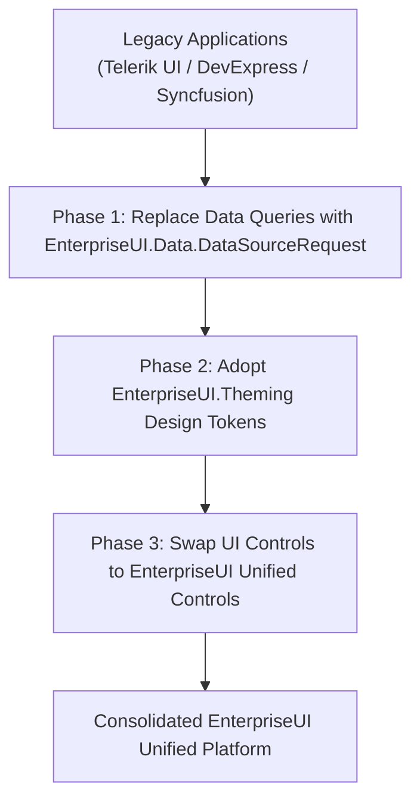

# EnterpriseUI Migration Guides

This guide assists enterprise engineering teams migrating from legacy third-party suites (**Telerik UI**, **DevExpress**, and **Syncfusion**) to the unified EnterpriseUI ecosystem.

---

## 1. Migration Strategy Overview

Migrating to EnterpriseUI yields three immediate commercial benefits:
1. **Elimination of Vendor Duplication**: Consolidate disparate licenses and inconsistent control behaviors into one platform.
2. **Performance Improvements**: Transition to modern .NET 8 Expression Tree compilation and constant-memory 2D virtualization.
3. **Cross-Platform Consistency**: Use the same design tokens, query descriptors, and validation rules across desktop and web applications.



---

## 2. Telerik UI to EnterpriseUI Migration Matrix

| Telerik UI Component | EnterpriseUI Component | Notes & Changes |
|---|---|---|
| `RadGridView` / `TelerikGrid` | `EnterpriseUI.Grids.DataGrid<T>` | Replace `CompositeFilterDescriptorCollection` with `EnterpriseUI.Data.CompositeFilterDescriptor`. Use `Columns.Add(new GridColumn { Field = "..." })`. |
| `RadTreeList` | `EnterpriseUI.Grids.TreeList<T>` | Set `KeyFieldName` and `ParentFieldName` identically. |
| `RadPivotGrid` | `EnterpriseUI.Grids.PivotGrid<T>` | Map `PivotField` with `PivotArea.Row`, `Column`, or `Data`. |
| `RadRibbonBar` | `EnterpriseUI.Navigation.RibbonBar` | Map `RibbonTab`, `RibbonGroup`, and `RibbonItem`. |
| `RadScheduler` | `EnterpriseUI.Scheduling.Scheduler` | Directly compatible with standard RFC 5545 recurrence rules. |
| `RadChartView` | `EnterpriseUI.Charts.Chart` | Set `Series.Add(new ChartSeries { Type = SeriesType.Column })`. |
| `RadDocking` | `EnterpriseUI.Layout.DockManager` | Use `DockManager.Dock(panel, DockPosition.Left)`. |

### Code Comparison: Telerik Grid vs. EnterpriseUI DataGrid

#### Before (Telerik UI):
```csharp
// Telerik WinForms / Blazor
var filter = new FilterDescriptor("UnitPrice", FilterOperator.IsGreaterThan, 50);
grid.FilterDescriptors.Add(filter);
grid.Rebind();
```

#### After (EnterpriseUI):
```csharp
// EnterpriseUI Unified
grid.FilterBy("UnitPrice", FilterOperator.IsGreaterThan, 50);
await grid.RefreshDataAsync();
```

---

## 3. DevExpress to EnterpriseUI Migration Matrix

| DevExpress Component | EnterpriseUI Component | Notes & Changes |
|---|---|---|
| `GridControl` + `GridView` | `EnterpriseUI.Grids.DataGrid<T>` | DevExpress separates the control from views (`TableView`, `CardView`); EnterpriseUI uses a consolidated model. |
| `TreeList` | `EnterpriseUI.Grids.TreeList<T>` | Direct replacement for hierarchical self-referencing datasets. |
| `PivotGridControl` | `EnterpriseUI.Grids.PivotGrid<T>` | Identical area-based dimensional analysis. |
| `RibbonControl` | `EnterpriseUI.Navigation.RibbonBar` | Directly translates pages, groups, and bar items. |
| `SchedulerControl` | `EnterpriseUI.Scheduling.Scheduler` | Unified appointment model with timezone awareness. |
| `DockManager` / `DocumentManager` | `EnterpriseUI.Layout.DockManager` | Supports floating, tabbed MDI, and pinned dock panels. |
| `XtraReport` | `EnterpriseUI.Reporting.ReportDefinition` | Band-oriented layout engine (`BandType.Detail`, `ReportHeader`). |

### Code Comparison: DevExpress GridControl vs. EnterpriseUI DataGrid

#### Before (DevExpress):
```csharp
// DevExpress GridControl
gridView1.Columns["Price"].SortOrder = DevExpress.Data.ColumnSortOrder.Descending;
gridView1.ActiveFilterCriteria = new BinaryOperator("Price", 50, BinaryOperatorType.Greater);
```

#### After (EnterpriseUI):
```csharp
// EnterpriseUI Unified
grid.SortBy("Price", ListSortDirection.Descending);
grid.FilterBy("Price", FilterOperator.IsGreaterThan, 50);
```

---

## 4. Syncfusion to EnterpriseUI Migration Matrix

| Syncfusion Component | EnterpriseUI Component | Notes & Changes |
|---|---|---|
| `SfDataGrid` | `EnterpriseUI.Grids.DataGrid<T>` | Map column definitions and wire up `DataSourceResult`. |
| `SfChart` | `EnterpriseUI.Charts.Chart` | Series models map to `ChartSeries` and `ChartDataPoint`. |
| `SfRibbon` | `EnterpriseUI.Navigation.RibbonBar` | Map tabs, groups, and command buttons. |
| `SfScheduler` | `EnterpriseUI.Scheduling.Scheduler` | Replace custom appointments with `EnterpriseUI.Scheduling.Appointment`. |

---

## 5. Common Migration Pitfalls & Mitigations

1. **Direct GDI or DOM Manipulation**: Legacy WinForms code often hooked deep Windows messages (`WndProc`). In EnterpriseUI, use the decoupled `OnPaint` override or `RenderNode` virtual DOM.
2. **Synchronous Data Calls**: Legacy code often made blocking database calls on UI threads. EnterpriseUI data methods are fully asynchronous (`await grid.RefreshDataAsync(cancellationToken)`).
3. **Hardcoded Color Brushes**: Replace hardcoded `Color.Blue` or `#0000ff` with `ThemeManager.Instance.CurrentTheme.GetToken(DesignTokens.Primary)`. This guarantees automated dark mode and theme switching.
