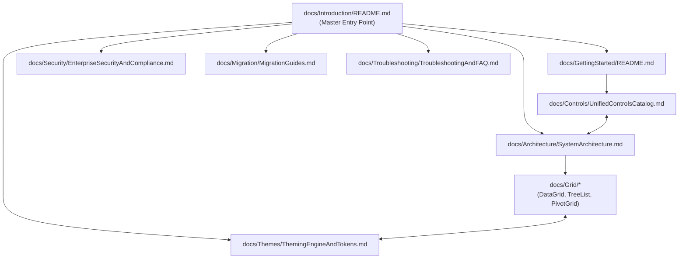
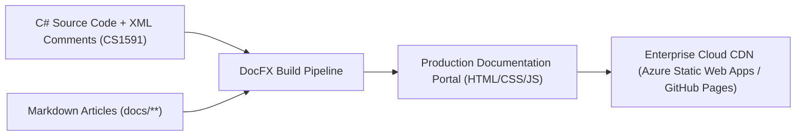

# EnterpriseUI Documentation Strategy, Governance & Roadmap

This document establishes the official governance plan, search architecture, automation pipeline, and release roadmap for EnterpriseUI documentation.

---

## 1. Documentation Information Architecture & Cross-Linking Strategy



### Cross-Linking Rules
1. **Explicit Relative Links**: All document cross-references utilize relative Markdown paths (e.g., `[DataGrid Guide](../Grid/ArchitectureGuide.md)`).
2. **Anchor Stability**: Header IDs are generated deterministically to ensure bookmark and deep-link longevity across versions.
3. **Symbol Deep Links**: Every documented C# class and interface points directly to its source definition.

---

## 2. Search & Indexing Strategy

1. **Client-Side Full-Text Search**: Integration with Lunr.js / Algolia DocSearch for instant indexing across all Markdown topics.
2. **Keyword Synonyms**: Search aliases map legacy terminology to EnterpriseUI terms (e.g., searching for *"GridView"* or *"RadGridView"* resolves directly to *DataGrid*).
3. **Structured Metadata Frontmatter**: Every document includes YAML frontmatter with tags, version, and audience targeting.

---

## 3. Documentation Automation Strategy (DocFX & CI/CD)

EnterpriseUI utilizes **DocFX** and Roslyn XML documentation comments to generate static HTML documentation portals continuously:



### Automated Command in CI:
```bash
docfx metadata docs/docfx.json
docfx build docs/docfx.json -o ./_site
```

---

## 4. Release Notes Template

```markdown
# EnterpriseUI Release Notes - Version [X.Y.Z]

**Release Date**: YYYY-MM-DD  
**Target Runtimes**: .NET 8.0 LTS (.NET 9+ Ready)

### 🚀 Highlights & New Features
- [Feature 1]: Summary of capability and business value.
- [Feature 2]: Cross-platform support updates.

### ⚡ Performance Improvements
- [Optimization 1]: Metric comparison (e.g., -25% memory consumption during 2D grid scrolling).

### 🛠️ Breaking Changes & Migration Steps
- [Breaking Change 1]: Description of change and before/after code migration snippet.

### 🐛 Bug Fixes & Stability
- [Fix 1]: Resolved edge-case in RFC 5545 recurrence calculation.
- [Fix 2]: Enhanced WCAG 2.2 AA screen reader announcement timing.
```

---

## 5. Documentation Governance Plan

1. **Zero-Undocumented Policy**: Any pull request introducing a new public class, property, or method must include complete XML doc comments and corresponding Markdown guide updates before merge approval.
2. **Review Cadence**: Technical documentation is audited quarterly by the Principal Software Architect and Documentation Lead.
3. **Deprecation Window**: Deprecated APIs must remain documented with obsolete warnings for at least two LTS releases before removal.
