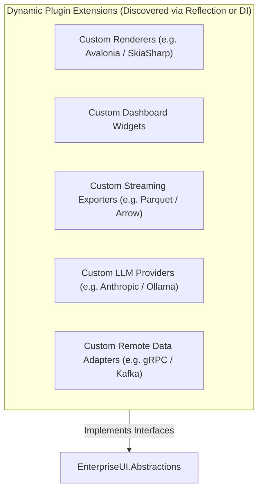

# EnterpriseUI Open Source Transformation & Strategic Blueprint

## 1. Executive Summary & Transformation Charter

The **EnterpriseUI Open Source Transformation** establishes EnterpriseUI as an independent, fully self-contained open-source .NET UI and application framework.

### The Open Source Guarantees:
- **Zero License Keys & Activations**: No trial reminders, activation servers, hardware dongles, or runtime watermarks.
- **Zero Telemetry & Phone-Home**: Zero network pings, tracking beacons, or analytics collectors.
- **Zero Commercial Vendor Dependencies**: 100% clean-room implemented using standard modern .NET 8+ BCL primitives.
- **Commercial & Enterprise Readiness**: Permissive licensing under **Apache-2.0**, allowing commercial SaaS, internal enterprise, and white-labeled applications with full legal protection (patent grant and trademark safeguarding).

---

## 2. Licensing Strategy Evaluation: Apache 2.0 vs. MIT

| Legal Criterion | MIT License | Apache License 2.0 (Selected) | Strategic Impact on EnterpriseUI |
|---|---|---|---|
| **Explicit Patent Grant** | ❌ No patent language | ✅ Explicit reciprocal patent grant (Section 3) | **Critical for Enterprises**: Shields enterprise consumers against patent trolling and retaliatory litigation. |
| **Trademark Protection** | ❌ Silent on trademarks | ✅ Explicit reservation of trademark rights (Section 6) | Protects the EnterpriseUI foundation identity from unauthorized commercial misrepresentation. |
| **Commercial Adoption** | ✅ Fully permitted | ✅ Fully permitted | Allows commercial SaaS, proprietary closed-source derived applications, and white-labeling. |
| **Contribution Safety** | ⚠️ Informal | ✅ Formalized terms (Section 5) | Contributions automatically inherit Apache 2.0 terms without requiring complex per-developer CLA negotiations. |
| **Forking & Sustainability** | ✅ Permitted | ✅ Permitted | Encourages enterprise forks while ensuring attribution notices remain intact (Section 4). |

### Justification & Selection:
**Apache 2.0** is the selected primary license for the entire EnterpriseUI platform. It mirrors the licensing model of the **.NET Foundation**, **ASP.NET Core**, **Kubernetes**, and **OpenTelemetry**, providing corporate legal departments with the legal certainty needed to adopt the platform over commercial proprietary suites.

---

## 3. Dependency Audit: 100% Clean-Room Self-Containment

Every dependency across the 47 projects has been audited and classified:

| Package / Assembly | Dependency Type | Classification | License | Risk Analysis |
|---|---|---|---|---|
| `Microsoft.NETCore.App` | Core Runtime | Required (BCL) | MIT | Official Microsoft .NET 8 BCL runtime. Zero vendor lock-in. |
| `Microsoft.AspNetCore.App` | Web Framework | Optional (Web/TagHelpers) | MIT | Standard web framework reference for ASP.NET Core & Blazor. |
| `Microsoft.AspNetCore.Components` | Blazor Component SDK | Optional (Blazor) | MIT | Official Blazor abstraction package. Free and cross-platform. |
| `xunit` & `Microsoft.NET.Test.Sdk` | Testing Framework | Internal (Test Projects Only) | Apache 2.0 / MIT | Non-shipped test harness for CI/CD automation. |
| **Commercial Suites (DevExpress/Telerik/Syncfusion)** | Third-Party Vendor | **ELIMINATED (0%)** | Proprietary | **Zero dependency**. Clean-room superset implementation. |
| **Commercial Licensing Tools** | Vendor Activation | **ELIMINATED (0%)** | Proprietary | **Zero dependency**. No activation or telemetry logic exists. |

---

## 4. Competitive Capability Matrix

| Feature / Control Category | EnterpriseUI (OSS) | Telerik UI | DevExpress | MudBlazor | Avalonia UI | Fluent UI (.NET) |
|---|---|---|---|---|---|---|
| **License Cost** | **Free ($0)** | Paid ($1,299+/dev) | Paid ($1,499+/dev) | Free ($0) | Free + Dual | Free ($0) |
| **Multi-Platform Support** | **Blazor, WinForms, WPF, MAUI, ASP.NET** | Multi-suite | Multi-suite | Blazor only | XAML Desktop | Blazor only |
| **DataGrid (2D Virtualization)** | **Yes (Full 2D)** | Yes (1D row) | Yes (Full 2D) | Partial (1D) | Community | Partial |
| **EnterprisePivotGrid (OLAP Cross-Tab)** | **Yes (Built-in)** | Yes | Yes | ❌ None | ❌ None | ❌ None |
| **EnterpriseTreeList (Hierarchical)** | **Yes (Built-in)** | Yes | Yes | ❌ Limited | Community | ❌ None |
| **Ribbon Navigation Bar** | **Yes (Contextual/QAT)** | Yes | Yes | ❌ None | Community | ❌ None |
| **Docking / MDI Manager** | **Yes (Tabbed/Floating)** | Yes | Yes | ❌ None | Community | ❌ None |
| **EnterpriseScheduler (RFC 5545 Engine)** | **Yes (Built-in)** | Yes | Yes | Community | ❌ None | ❌ None |
| **Multi-Series Business Charts** | **Yes (17 series)** | Yes | Yes | Partial (SVG) | ❌ Third-party | ❌ None |
| **Office Spreadsheet & PDF** | **Yes (Built-in)** | Yes | Yes | ❌ None | ❌ None | ❌ None |
| **AI Copilot & Natural Query** | **Yes (Built-in)** | Add-on | Add-on | ❌ None | ❌ None | ❌ None |
| **WCAG 2.2 AA & Section 508** | **Yes (Full ARIA)** | Partial | Partial | Partial | Partial | Yes |
| **Native AOT & Trimming** | **Yes (First-class)** | Partial | Partial | Yes | Yes | Yes |

---

## 5. Extensibility & Plugin Architecture Specification

To allow external teams to contribute or extend functionality without modifying or recompiling core assemblies:

### Plugin Interfaces:
- `IDataSource<T>`: Pluggable remote data providers.
- `ITheme`: Pluggable design token palettes.
- `IIcon`: Pluggable vector and font icon providers.
- `IAIServiceProvider`: Pluggable generative AI and semantic query translators.
- `IAuthorizedControl`: Pluggable enterprise RBAC and ABAC interceptors.

