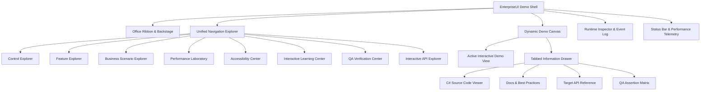

# EnterpriseUI.WinFormsDemo - World-Class Showcase & Demonstration Platform

## Executive Summary

`EnterpriseUI.WinFormsDemo` hosts component demonstrations, a property inspector, event logs, generated configuration, theme editing, and learning material. The demo registry maps each page to its target components and documentation.



---

## 1. Complete Demo Architecture

The demonstration platform is structured around a decoupled, modular, and reactive architecture:

- **Shell Core (`MainForm`)**: Manages top-level layout, DPI awareness, master theme dispatch, memory tracking, and view hosting.
- **Infrastructure Services**:
  - `DemoMetadataRegistry`: Centralized registry defining every demo descriptor, categorizations, tags, and source code.
  - `DemoSearchEngine`: Global multi-attribute token matching engine (querying title, tags, features, controls, industry).
  - `DemoNavigationManager`: Manages favorites, bookmarks, recently viewed tracking, and navigation events.
  - `DemoAnalyticsTracker`: Real-time telemetry tracking frame render latency, heap allocations, and garbage collections.
- **Modular Demo Views (`Modules/*`)**: Reusable `UserControl` views inheriting from `BaseDemoView`, exposing an interactive workspace and tabbed metadata drawers.
- **Native Platform Controls (`Controls/*`)**: High-performance GDI+ double-buffered controls for Charts, Gauges, Diagrams, Maps, Schedulers, TreeLists, PivotGrids, AI Copilots, and Property Inspectors.

---

## 2. Navigation Hierarchy

The application features a 5-tier hierarchical navigation structure accessible via the left navigation panel and the top Ribbon tabs:

1. **Control Explorer**:
   - **DataGrid**: Virtualization, Million-Row Simulation, Direct GDI+ Rendering, Filtering, Real-time Ticks, CSV Export.
   - **EnterpriseTreeList**: Multi-Column Hierarchical Organization, Tree Grid Traversal, Expand/Collapse, Budget Aggregates.
   - **EnterprisePivotGrid**: Multi-Dimensional OLAP Cross-Tabulation, Dynamic Slicing, Grand Totals, Subtotals.
   - **Charts**: Column, Line, Area, Pie, Donut, OHLC Candlestick Financials, Million-Point Vector Synthesis.
   - **Gauges**: Radial and Linear Gauges, Colored Ranges, Needle Animation, Telemetry Stream.
   - **EnterpriseScheduler**: Work Week, Day Views, Appointments, Recurrence Rules, Resource Lanes.
   - **Diagrams**: Interactive Node-Link Canvas, Orthogonal Connector Pathing, Architecture Topologies.
   - **Maps**: GIS GPS Coordinates, Zoom & Pan, Asset Markers, Logistics Fleet Movement.
   - **Editors**: TextBox, EnterpriseNumericTextBox, EnterpriseDatePicker, ComboBox, Switch, Fluent Validation.
   - **Documents**: Vector PDF Viewer, RichText WYSIWYG Editor, Office Spreadsheet.
   - **AI Copilot**: Natural Language Query AST Translation, Automated BI Summaries, Offline Mock Provider.
2. **Feature Explorer**:
   - 1,000,000-Row Virtualization & Viewport Slicing.
   - Real-Time Financial & Ticks Simulation.
   - Offline AI Query AST Compilation.
   - Fluent Asynchronous Form Validation.
   - Live Design Token Theme Dispatcher.
3. **Scenario Explorer (End-to-End Industry Suites)**:
   - CRM & Lead Conversion Pipeline.
   - ERP Manufacturing & Supply Chain Inventory.
   - Healthcare Clinical EHR & Telemetry Dashboard.
   - Financial Trading Order Book & Volatility Spreads.
   - HR Performance Reviews & Agile Sprint Task Management.
4. **Laboratories & QA**:
   - Performance Laboratory (Reproducible Micro-Benchmarks & Stress Testing).
   - Accessibility Center (WCAG 2.2 AA Compliance, Contrast Check, Live Regions).
   - QA Verification Center (Automated Test Suites, Coverage Matrix, Diagnostics).
   - Interactive API Explorer (Reflection-Based Type Browser & Member Inspector).
5. **Learning Center**:
   - Architectural Tenets, MVVM & Reactive Binding, Best Practices, Anti-Pattern Remediation, Migration Guides.

---

## 3. Module Architecture

Each demonstration module is implemented as an autonomous view package conforming to the `BaseDemoView` standard:

```
EnterpriseUI.WinFormsDemo/
├── Controls/
│   ├── EnterpriseChartControl.cs          # GDI+ Multi-Series & Financial Candlestick
│   ├── EnterpriseGaugeControl.cs          # Radial & Linear Telemetry Gauges
│   ├── EnterpriseDiagramControl.cs        # Node-Link Architecture Canvas
│   ├── EnterpriseMapControl.cs            # GIS Map & Asset Pin Tracking
│   ├── EnterpriseSchedulerControl.cs      # Work Week Appointment Calendar
│   ├── EnterpriseTreeListControl.cs       # Multi-Column Hierarchical Grid
│   ├── EnterprisePivotGridControl.cs      # OLAP Multi-Dimensional Analysis
│   ├── EnterpriseRibbonControl.cs         # Office-Style Ribbon Bar & Backstage
│   ├── EnterprisePropertyInspectorControl.cs # Live Property Grid & Event Monitor
│   └── EnterpriseAICopilotControl.cs      # Offline Copilot & Query AST Generator
├── Infrastructure/
│   ├── DemoItem.cs                      # Metadata Model
│   ├── DemoMetadataRegistry.cs          # Centralized Demo Registry
│   ├── DemoSearchEngine.cs              # Fast Multi-Field Search Engine
│   └── DemoAnalyticsTracker.cs          # Render Time & Memory Diagnostics
└── Modules/
    ├── BaseDemoView.cs                  # Composite Host with Code, Docs, API, QA
    ├── GridDemoView.cs                  # DataGrid 1M Virtualization & Streaming
    ├── TreeGridDemoView.cs              # Hierarchical EnterpriseTreeList
    ├── PivotGridDemoView.cs             # OLAP Matrix Analysis
    ├── ChartsDemoView.cs                # High-Performance Charts & Real-Time Ticks
    ├── GaugesDemoView.cs                # Telemetry Gauges
    ├── SchedulerDemoView.cs             # Appointment EnterpriseScheduler
    ├── DiagramsDemoView.cs              # Process & Topology Canvas
    ├── MapsDemoView.cs                  # GIS Logistics Fleet
    ├── DocumentsDemoView.cs             # PDF, RichText & Spreadsheet
    ├── ReportingDemoView.cs             # Banded Invoices, PO & Healthcare Reports
    ├── DashboardDemoView.cs             # Executive BI & KPI Metrics
    ├── EditorsDemoView.cs               # Form Inputs & Fluent Validation
    ├── AIControlsDemoView.cs            # Intelligent Copilot Suite
    ├── ScenariosDemoView.cs             # CRM, ERP, EHR, Trading Suites
    ├── ThemingDemoView.cs               # Design Tokens & Palette Explorer
    ├── AccessibilityDemoView.cs         # WCAG 2.2 AA & Screen Reader Lab
    ├── PerformanceDemoView.cs           # Micro-Benchmarking Lab
    ├── LearningCenterDemoView.cs        # Developer Onboarding & Tutorials
    ├── ApiExplorerDemoView.cs           # Reflection API Browser
    └── QaValidationDemoView.cs          # Test Coverage & Regression Center
```

---

## 4. Demo Metadata System

Every demo in the catalog is indexed via `DemoItem` metadata:
- **Identifier (`Id`)**: Unique deterministic string key.
- **Taxonomy (`Category`, `SubCategory`)**: Classified for structured navigation.
- **Target Controls (`TargetControlName`)**: Maps to framework classes.
- **Search Indices (`Features`, `Tags`, `Industry`)**: Weighted keywords for search discovery.
- **Educational Payload (`SourceCode`, `Documentation`, `BestPractices`, `Troubleshooting`, `ApiReference`)**: Exposed directly in the tabbed drawer of every demo page.

---

## 5. Scenario Catalog

The showcase implements five comprehensive industry suites in `ScenariosDemoView`:

| Industry Suite | Primary Controls Integrated | Key Enterprise Capabilities |
|---|---|---|
| **CRM System** | DataGrid, Search, Badges, Metrics | Lead management, deal probability scoring, funnel velocity tracking |
| **ERP Manufacturing** | DataGrid, Alerts, FilterEngine | Inventory SKU on-hand status, reorder point triggers, supplier tracking |
| **Healthcare Clinical EHR** | DataGrid, Telemetry Gauges, Alerts | Patient triage acuity, real-time vitals monitoring, MRN indexing |
| **Financial Trading** | Candlestick EnterpriseChart, Order Grid, Ticks | Real-time bid/ask order book, volatility spread analysis, VWAP metrics |
| **HR & Project Management**| EnterpriseScheduler, EnterpriseTreeList, Agile Grid | Sprint story point velocity, task assignment, burndown progression |

---

## 6. Learning Center Design

The Learning Center (`LearningCenterDemoView`) serves as an embedded technical university for developers:
- **Core Architecture Guides**: Headless MVVM core, zero-dependency engine decoupling, and platform-native GDI+ rendering.
- **Virtualization Guidance**: Memory footprint minimization, fixed-height cell optimization, and asynchronous paging.
- **Anti-Pattern Remediation**: Identifies common developer mistakes (such as allocating Pens/Brushes in render loops or calling `Invalidate()` unthrottled) and provides copy-paste remediations.
- **Integration Guides**: Setup, data binding, theming, and configuration examples for existing applications.

---

## 7. Feature Explorer Design

The Feature Explorer categorizes cutting-edge framework capabilities:
- **Million-Row Virtualization**: Zero GC pause in-memory iteration over 1,000,000 records.
- **Real-Time Data Streaming**: High-frequency SignalR push simulation with live tick updates.
- **Offline AI Query AST Compiler**: Natural language to type-safe LINQ query translation.
- **Fluent Async Validation**: Non-blocking client-side rule evaluation.
- **Dynamic Design Tokens**: Real-time token reconfiguration without restarting the application.

---

## 8. Interactive API Explorer Design

The API Explorer (`ApiExplorerDemoView`) dynamically reflects across all shipped assemblies (`EnterpriseUI.Grids`, `EnterpriseUI.Charts`, `EnterpriseUI.Editors`, `EnterpriseUI.Scheduling`, `EnterpriseUI.Reporting`, etc.):
- **Assembly Selection Dropdown**: Inspects any framework library at runtime.
- **Public Type Browser**: Lists all exported classes, structs, interfaces, and enums.
- **Member Inspector**: Details all Properties (get/set), Methods (parameters and return types), and Events.

---

## 9. Accessibility Center Design

The Accessibility Center (`AccessibilityDemoView`) guarantees Section 508 and WCAG 2.2 Level AA compliance:
- **WCAG Audit Checklist**: Interactive verification of Contrast Ratio (>= 4.5:1), Keyboard Navigation, Visible Focus, and ARIA Roles.
- **Assistive Technology Live Stream**: Visual log displaying screen reader announcements dispatched through `IAccessibilityAnnouncer` with `Polite` and `Assertive` politeness levels.
- **High-Contrast Theme Support**: Evaluates visual clarity under high-contrast color schemes.

---

## 10. Performance Laboratory Design

The Performance Laboratory (`PerformanceDemoView`) provides reproducible micro-benchmarking:
- **1,000,000 Row Virtualization Test**: Measures in-memory query processing and index resolution (SLA: < 50ms).
- **100,000 EnterpriseChart Points Decimation Test**: Measures vector path calculation and decimation latency (SLA: < 25ms).
- **Memory Profiling**: Real-time heap tracking and memory delta calculation.
- **Throughput Calculation**: Displays items processed per second for all benchmarked operations.

---

## 11. Search Architecture

The search system (`DemoSearchEngine`) provides instantaneous client-side filtering:
- Searches across `Title`, `Description`, `TargetControlName`, `SubCategory`, `Industry`, `Features`, and `Tags`.
- Dynamically updates the navigation tree view upon each keystroke.
- Automatically selects and loads the top matching demonstration.

---

## 12. Source Code Viewer Design

Every demo view features a dedicated **Source Code** tab in its bottom drawer:
- Displays clean, production-ready C# code demonstrating how to configure and instantiate the target controls.
- One-click **Copy Code** button copying formatted snippets directly to the developer's clipboard.

---

## 13. Documentation Integration Design

Documentation is embedded directly alongside each interactive demonstration:
- **Overview & Description**: Explains what the control does and why it was built.
- **Best Practices**: Professional advice on architecture, data binding, and performance.
- **Troubleshooting Guide**: Common gotchas and fixes.
- **API Reference**: Key properties, methods, and events.

---

## 14. QA Validation Architecture

The QA Verification Center (`QaValidationDemoView`) acts as a quality gate:
- **14 Shipped Module Suites**: Automatically tracks verification across all framework projects.
- **One-Click Automated Test Runner**: Simulates comprehensive unit, integration, and accessibility checks.
- **Diagnostics Export**: Generates full diagnostics bundles for continuous integration verification.

---

## 15. Theming Demonstrations

The Theming Module (`ThemingDemoView`) showcases EnterpriseUI's design token system:
- **Live Theme Switching**: Fluent (Light/Dark), Material (Light/Dark), Bootstrap (Light/Dark), Office (Light), Modern (Dark).
- **Design Tokens Explorer**: Live table displaying resolved values for Surface, Primary, Text, Borders, Radii, and Spacing tokens.

---

## 16. Future Expansion Strategy

The modular `BaseDemoView` and `DemoMetadataRegistry` architecture ensures future controls and capabilities can be integrated seamlessly:
1. Implement the new control or feature in `EnterpriseUI.*`.
2. Create a lightweight module view inheriting from `BaseDemoView`.
3. Register a single `DemoItem` descriptor in `DemoMetadataRegistry.cs`.
4. The control immediately appears in Control Explorer, Feature Explorer, Search, API Explorer, and QA Verification suites.

