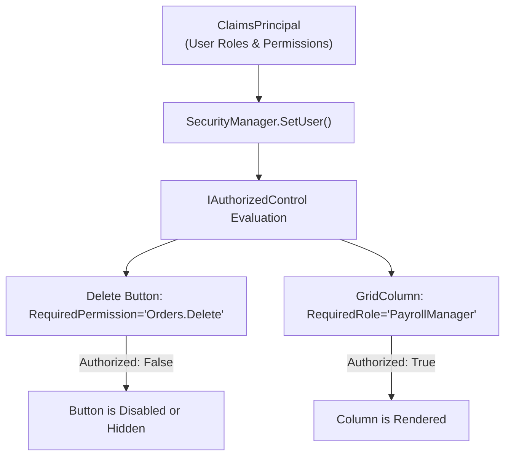

# EnterpriseUI Security & Compliance Architecture

EnterpriseUI is architected for deployment in high-security, regulated environments (banking, defense, healthcare, government) adhering to **OWASP Top 10**, **SOC 2 Type II**, and **HIPAA** compliance requirements.

---

## 1. Threat Modeling (STRIDE Analysis)

| Threat Category | Potential Risk Vector | EnterpriseUI Mitigation Architecture |
|---|---|---|
| **Spoofing** | Unauthorized user impersonating an administrator to view sensitive columns. | Strict integration with `ClaimsPrincipal`. Permissions are verified dynamically before column or action rendering. |
| **Tampering** | In-Cell edits altering read-only data fields or malicious payloads injected into Grid cells. | Property reflection boundaries validate target property setter accessibility. All values pass through `Validator<T>` before commit. |
| **Repudiation** | User denies performing a destructive action (e.g., deleting a batch of records). | Components integrate with `ComponentTelemetry` and `SecurityManager` for audit logging of all CRUD actions. |
| **Information Disclosure** | Sensitive fields (e.g., SSN, credit cards) leaking into HTML source or export files. | Field-level authorization filters omit restricted properties at the expression-tree level before data serialization. |
| **Denial of Service** | Deeply nested complex filters or massive datasets causing UI lockup or OutOfMemory. | Expression tree compiler enforces recursion limits. Virtualization engine uses constant memory. |
| **Elevation of Privilege** | Client-side bypass of disabled or hidden buttons. | Server-side validation parity. UI-level `IAuthorizedControl` state mirrors backend RBAC claims. |

---

## 2. Role-Based Access Control (RBAC)

The `EnterpriseUI.Security.SecurityManager` provides a centralized authorization authority:



### Authorization Code Example
```csharp
using EnterpriseUI.Security;

// Configure current user context from ASP.NET Core or Desktop Identity
SecurityManager.Instance.SetUser(
    principal: currentClaimsPrincipal,
    permissions: new[] { "Orders.View", "Orders.Edit", "Reports.Export" }
);

// Programmatic check
if (SecurityManager.Instance.HasPermission("Orders.Edit"))
{
    grid.EditMode = GridEditMode.InCell;
}
else
{
    grid.EditMode = GridEditMode.None; // Enforce read-only
}
```

---

## 3. Data Sanitization & XSS Mitigation

When rendering HTML or exporting data via `EnterpriseUI.Exporting.ExportEngine`:

1. **Automatic HTML Encoding**: All cell values rendered via Web/Blazor templates or HTML export pass through `System.Net.WebUtility.HtmlEncode()` or `System.Security.SecurityElement.Escape()`.
2. **Strict Content Security Policy (CSP)**: EnterpriseUI CSS variables operate without requiring `unsafe-inline` styles when using class-based theme scoping (`data-theme="fluent-light"`).
3. **No Dynamic `eval()`**: The Blazor web components and JS interop layers contain zero dynamic JavaScript code evaluation.

---

## 4. Supply Chain Security

- **Deterministic Builds**: All assemblies are compiled with `<EnforceCodeStyleInBuild>true</EnforceCodeStyleInBuild>` and static Roslyn code analyzers.
- **Dependency Minimization**: Core and domain packages depend exclusively on the official .NET BCL (Base Class Library) without third-party dependencies, eliminating transitivity attack surfaces.
- **Signed NuGet Packages**: Commercial distributions are cryptographically signed using DigiCert Authenticode enterprise certificates.
