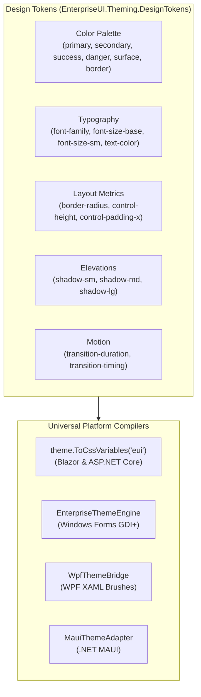

# EnterpriseUI Theming System & Design Tokens Guide

Theming in EnterpriseUI is built around **Design Tokens**, token inheritance, and universal cross-platform translation. A single theme definition drives styling across Web (CSS Variables), Windows Forms (GDI+ brushes & pens), WPF (XAML SolidColorBrushes), and Mobile (MAUI colors).

---

## 1. Design Token Architecture

Design tokens represent the visual atoms of the design system. Tokens are defined in [`DesignTokens.cs`](file:///C:/Users/muhahame/Downloads/Hobbies/Projects/WinFormUiControls/src/EnterpriseUI.Theming/DesignTokens.cs):



---

## 2. Complete Token Inventory

| Token Name | Constant | Description | Example (Fluent Light) |
|---|---|---|---|
| `primary` | `DesignTokens.Primary` | Primary brand accent color | `#0078d4` |
| `primary-hover` | `DesignTokens.PrimaryHover` | Hover state for primary actionables | `#106ebe` |
| `primary-active` | `DesignTokens.PrimaryActive` | Active / pressed state | `#005a9e` |
| `primary-text` | `DesignTokens.PrimaryText` | High-contrast text on primary background | `#ffffff` |
| `secondary` | `DesignTokens.Secondary` | Neutral action background | `#edebe9` |
| `surface` | `DesignTokens.Surface` | Card, dialog, and grid background | `#ffffff` |
| `surface-alt` | `DesignTokens.SurfaceAlt` | Alternate row and header background | `#faf9f8` |
| `background` | `DesignTokens.Background` | Application canvas background | `#f3f3f3` |
| `border-color` | `DesignTokens.BorderColor` | Standard control borders | `rgba(0, 0, 0, 0.08)` |
| `font-family` | `DesignTokens.FontFamily` | System font stack | `'Segoe UI Variable', sans-serif` |
| `font-size-base` | `DesignTokens.FontSizeBase` | Body text size | `14px` |
| `border-radius` | `DesignTokens.BorderRadius` | Control border curvature | `4px` |
| `control-height` | `DesignTokens.ControlHeight` | Standard input and button height | `32px` |
| `shadow-md` | `DesignTokens.ShadowMd` | Elevation dropdown and popup shadow | `0 4px 8px rgba(0,0,0,0.14)` |

---

## 3. Built-In Themes

EnterpriseUI ships with 6 production-ready themes, each with Light and Dark modes:

1. **Fluent** (`BuiltInThemes.CreateFluent`): Microsoft Fluent Design 2 / Windows 11 style.
2. **Material** (`BuiltInThemes.CreateMaterial`): Google Material Design 3 elevation system.
3. **Bootstrap** (`BuiltInThemes.CreateBootstrap`): Bootstrap 5.3+ web standards.
4. **Office** (`BuiltInThemes.CreateOffice`): Microsoft 365 / Office desktop look and feel.
5. **Modern** (`BuiltInThemes.CreateModern`): Contemporary slate/indigo SaaS aesthetic.
6. **Default** (`BuiltInThemes.CreateDefault`): Neutral enterprise standard.

---

## 4. CSS Variable Compilation

On Web and Blazor platforms, calling `theme.ToCssVariables("eui")` compiles the dictionary into native CSS custom properties:

```css
:root[data-theme="fluent-light"] {
  --eui-primary: #0078d4;
  --eui-primary-hover: #106ebe;
  --eui-primary-active: #005a9e;
  --eui-primary-text: #ffffff;
  --eui-surface: #ffffff;
  --eui-surface-alt: #faf9f8;
  --eui-background: #f3f3f3;
  --eui-border-color: rgba(0, 0, 0, 0.08);
  --eui-font-family: 'Segoe UI Variable', 'Segoe UI', -apple-system, sans-serif;
  --eui-font-size-base: 14px;
  --eui-border-radius: 4px;
  --eui-control-height: 32px;
}
```

---

## 5. Runtime Theme Hot-Reloading

Themes can be hot-swapped dynamically without reloading the page or restarting the desktop application:

```csharp
using EnterpriseUI.Theming;
using EnterpriseUI.Theming.Themes;

// Switch to Dark mode
ThemeManager.Instance.ApplyTheme(BuiltInThemes.CreateFluent(ColorScheme.Dark));

// Or toggle scheme automatically
ThemeManager.Instance.SetColorScheme(ColorScheme.Dark);
```

All registered controls listen to `ThemeManager.Instance.ThemeChanged` and re-render automatically.

---

## 6. ThemeBuilder API

Create bespoke brand themes with full token inheritance:

```csharp
var customCorporateTheme = ThemeBuilder.Create("AcmeCorporate")
    .BasedOn(ThemeType.Modern)
    .WithColorScheme(ColorScheme.Light)
    .WithPrimaryColor("#ff6600", hover: "#e65c00", active: "#cc5200")
    .WithFontFamily("'Inter', 'Segoe UI', sans-serif")
    .WithBorderRadius("8px")
    .WithToken("custom-badge-color", "#00b294")
    .Build();

// Register and apply
ThemeManager.Instance.RegisterTheme(customCorporateTheme);
ThemeManager.Instance.ApplyTheme(customCorporateTheme);
```

---

## 7. Theme Designer Application

The `EnterpriseUI.ThemeDesigner` tooling package provides programmatic and UI capabilities to:
- Visually adjust token colors, typography, and metrics.
- Audit contrast ratios for WCAG compliance.
- Export theme definitions directly to CSS stylesheets, JSON tokens, or C# fluent builder code.
