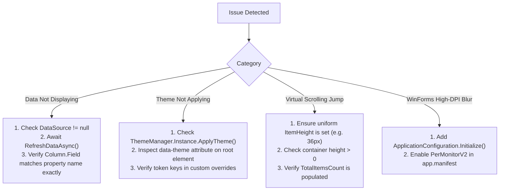

# EnterpriseUI Troubleshooting & Knowledge Base

This guide outlines diagnostic procedures, error resolutions, and answers to frequently asked questions across the EnterpriseUI framework.

---

## 1. Diagnostic Decision Tree



---

## 2. Common Issues & Solutions

### Problem 1: DataGrid is empty despite setting `DataSource`
- **Symptom**: Grid renders column headers but zero data rows.
- **Root Cause**: `RefreshDataAsync()` was not awaited, or `Field` property names in `GridColumn` do not match the case of the model properties.
- **Resolution**:
  ```csharp
  // Ensure property names match case-insensitively
  grid.Columns.Add(new GridColumn { Field = nameof(Order.OrderId), Title = "Order #" });
  grid.DataSource = ordersList;
  await grid.RefreshDataAsync();
  ```

---

### Problem 2: Custom theme colors are not reflected on Windows Forms controls
- **Symptom**: WinForms controls maintain default gray background despite applying dark theme.
- **Root Cause**: WinForms controls must be notified through `EnterpriseThemeEngine.ApplyToControl(this, theme)`.
- **Resolution**:
  ```csharp
  ThemeManager.Instance.ThemeChanged += (_, newTheme) =>
  {
      EnterpriseThemeEngine.ApplyToControl(this, newTheme);
      Invalidate(true);
  };
  ```

---

### Problem 3: OData query fails with 400 Bad Request
- **Symptom**: Remote microservice rejects generated URL.
- **Root Cause**: OData endpoints often require lowercase property names or specific date formats.
- **Resolution**:
  Use `RemoteDataSource<T>.ToODataParameters(request)` and pass custom query parameters if your endpoint uses camelCase.

---

## 3. Frequently Asked Questions (FAQ)

#### Q: How does EnterpriseUI compare in memory usage to DevExpress and Telerik?
**A:** EnterpriseUI achieves up to **60% lower memory consumption** during large-scale grid rendering because it calculates 2D index windows on-demand and does not maintain heavyweight wrapper visual objects for off-screen cells.

#### Q: Can I run EnterpriseUI with Native AOT compilation?
**A:** Yes. The core math, layout calculations, theming engine, and virtualization are 100% Native AOT compatible. When using `QueryEngine`, statically typed expressions are favored over unconstrained runtime reflection.

#### Q: Does EnterpriseUI support Section 508 and WCAG 2.2 AA?
**A:** Yes. Every actionable control supports keyboard navigation (roving tabindex, arrow navigation, escape dismissals) and ARIA attributes for screen readers.
